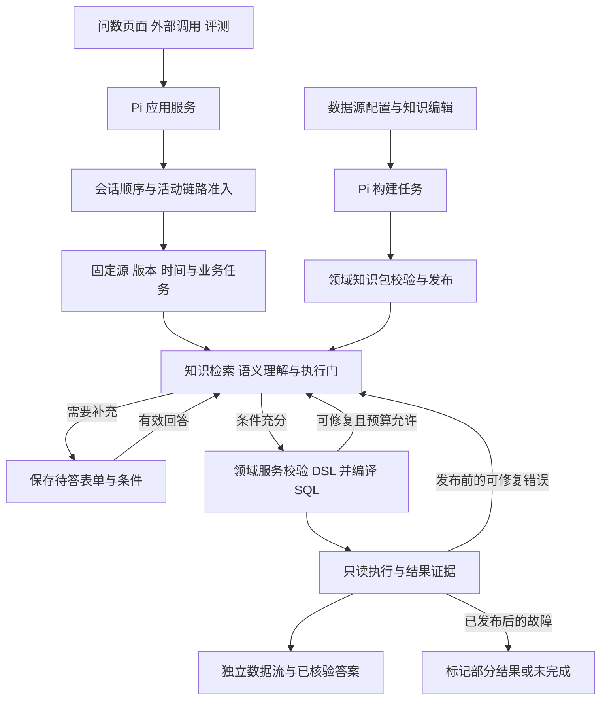

# Pi 智能问数产品需求文档

版本：v0.3 评审稿  
日期：2026-10-15  
适用项目：Pi-智能问数  
实现基线：Pi 提交 `550f1f3ecd75bf756ab3c379ca9503e808a6c6d1`  
交付状态：M0 运行基础已实现并验证，M1 基础查询子集已可运行；M1 接入/构建/映射页面及完整 P0 尚未完成。详见 [实施记录](implementation-progress.md) 与 [启动说明](../apps/medical-query/README.md)。

本产品面向医疗机构，让业务人员用自然语言查询已接入的数据、理解专业术语和指标，并在信息不足时通过追问补齐条件，获得可核验的结果。产品覆盖“接入数据—构建知识—维护口径—问询与续查—交付证据—反馈评测”的完整过程。

本版建议采用 **Pi Durable 管理会话与持久任务，Pi AI 统一模型调用，领域查询服务负责确定性规划校验、SQL 编译和只读执行**。初期复用已有 Python 领域模块，新增应用与交互在本项目实现。Pi 提供运行设施；医学定义、本院映射、查询约束和结果正确性仍是本产品的责任。

本文作为新项目的需求基线。旧项目文档保留为来源，其中“不得更换原框架”“保持旧接口路径”等原项目实施约束不直接约束新项目；后续较新的业务规则优先于最早 PRD。文中“必须”表示交付要求，不表示功能已实现。

## 1 产品目标与用户

### 1.1 目标

1. 业务人员可以完成数据查询、基础统计和有明确依据的指标解释，无需掌握 SQL。
2. 实施人员可以通过配置和知识维护接入不同医院的数据结构，减少为每家医院编写专用逻辑。
3. 系统保留用户条件，区分业务歧义、数据缺口与技术故障；不能回答时说明具体原因。
4. 每个数值答案可追溯到本次查询、数据源、条件、指标版本和结果依据。
5. 用同一执行入口支持聊天、外部调用与评测，能够比较版本质量、耗时和成本。

### 1.2 主要用户

| 用户 | 主要任务 | 产品需要提供 |
| --- | --- | --- |
| 医生、护士、药检影等业务人员 | 查询记录、筛选人群、查看检验或诊疗事实 | 自然语言输入、必要追问、真实结果表、时间与对象说明 |
| 质控、院感、运营与财务人员 | 按科室、时间、人群统计并核对指标 | 口径、分母、去重粒度、指标版本和计算依据 |
| 科研人员 | 构建队列、比较人群、复核查询条件 | 可重复的条件与计划、完整结果、证据及能力边界 |
| 信息科与实施人员 | 配置数据源、完善映射、排查错误 | 构建进度、缺口报告、映射工作台和诊断视图 |
| 业务知识维护人员 | 维护术语、指标和本院绑定 | 来源、版本、草稿、确认、差异及预览 |

按任务组织能力，不为每个岗位另建一个 Agent。角色可以影响候选排序和表达方式，不能改变指标定义或替代数据权限。

## 2 范围与交付层次

P0 是首个可用版本的必需范围；P1 是已纳入产品的后续交付范围。工程上先打通单条查询只是中间里程碑，不能据此宣告 P0 完成。

| 能力 | P0 首个可用版本 | P1 后续明确范围 |
| --- | --- | --- |
| 数据接入 | 配置页、测试连接、保存后自动构建、增量更新、发布与状态 | 随目标机构增加并验证数据库适配 |
| 知识维护 | 表列语义、术语、代码、关系、基础指标、确认样例及本院绑定 | 可信资料发现与解析、版本差异、建议箱和定期更新 |
| 交互 | 按源聊天、多轮条件继承、主动追问、动态表单、刷新恢复 | 更复杂的组合分析交互 |
| 查询 | 单源多表、过滤、排序、分组、基础聚合、去重、明确关联和存在判断 | 比率、简单派生、时间序列、每人最新及事件先后等通用算子，逐项验收 |
| 指标 | 定义解释、可计算状态、基础表达的计划与计算；基础指标跨院复用绑定 | 比率、派生、时序等扩展表达及跨院验证 |
| 输出 | 真实表格、分页、完整分块、自然语言说明、证据 | 基于已核验结果的简单图表与趋势展示 |
| 改进 | 业务文字反馈、有限修复、确认样例、任务级评测与版本对比 | 自动经验候选、去重与失效、分层上下文读取增强 |

本期业务数据源统一使用 **SQLite 文件**，后续围绕 Schema Linking（把业务问题对应到正确的表、字段、关系与取值）构造 mock 数据并做真实链路评测。两个异构源指结构、命名或代码不同的两个 SQLite 库，用于模拟不同医院，不要求引入第二种数据库。MySQL、PostgreSQL、Oracle 留作后续按需适配，不再作为 P0 出口条件。指标库不设固定词表上限；对于已支持的表达，新增术语、指标或医院绑定应通过页面或导入完成。

P0 同时交付可配置的单实例并发控制：同一会话按序执行，不同会话及独立评测用例可并行；活动链路和在途模型请求分别设限，默认均为 5，首期最高 10，详见第 9.2 节。

本期不做跨数据库联合查询、写入业务库、医嘱或申报等外部行动、临床诊疗决策、预测与因果分析、任意代码执行、通用插件市场、分布式任务平台。文书事实抽取及完整指南问答不属于本版结构化问数范围；P1 资料解析用于术语和指标知识。

## 3 相比旧需求的调整

| 旧描述或现状 | 本版决定 |
| --- | --- |
| 以 LangChain/LangGraph 六层图为实现中心 | 以产品任务和领域工具为中心，由 Pi 承担选定的运行职责；六阶段仍作为证据视图 |
| 当前主聊天、外部接口和反馈评测各走一条链 | 所有入口调用同一应用服务和领域查询能力，不再复制流水线 |
| 高频问题命中历史答案后直接返回 | 定义可引用有效知识直接解释；实时数值每次重新取数，经验复用方法和口径 |
| 空结果或模型低置信可触发重试 | 正常空集是有效结果；追问、修复必须有具体缺项或失败证据 |
| 对话摘要承担上下文记忆 | 摘要辅助理解，精确条件、待答表单和版本保存在结构化任务状态 |
| 早期只有配置文件和少量代码内词表 | 配置页、自动知识构建、映射工作台、术语指标中心属于明确交付 |
| 点赞比例或链路健康度显示为准确率 | 分别显示反馈有用率和检查结果；业务准确率来自有标准答案的评测 |
| 数据传完但答案失败时统一表现为失败 | 分别展示数据完整性和答案状态，保留已完整收到的数据；整项任务仍不可冒称全部成功 |
| 初版跨源查询与后续单源方案并存 | 每个任务固定一个数据源，支持该源内多表；切源新建会话 |
| 首期同时验证 SQLite 与 MySQL | 收敛为 SQLite 合成业务库；先验证 Schema Linking 与真实查询，再按需扩展方言 |
| 并发配额只作为待测参数 | 明确会话串行、活动链路与模型请求双重限额，默认 5、最高 10，评测共享总额度 |

## 4 页面与典型流程

### 4.1 页面地图

| 页面 | 主要内容 |
| --- | --- |
| 问数工作台 | 当前数据源、新对话、答案模型选择、聊天、已确认条件、追问表单、结果表、反馈 |
| 证据与诊断区域 | 保留中央聊天及两侧可折叠区域的交互习惯；右侧按轮次展示六阶段证据，左侧按需查看实际提示词与模型信息 |
| 数据源管理与构建详情 | 新建/配置、测试连接、构建状态、实际处理计数、覆盖与缺口、重试和进入问答 |
| 映射工作台 | 当前源的表列、别名、代码、关联、指标绑定和样例；确认、修订、驳回、预览与历史 |
| 术语与指标中心 | 通用定义与本院绑定分开显示；来源、适用范围、版本、能力状态；P1 增加资料建议箱 |
| 评测与反馈视图 | 用例、任务结果、版本对比、错误归因、反馈处理及耗时成本；与实施入口整合 |
| 外部调用验证页 | 选择数据源、提交问题、查看接收进度与有限预览、完整性和停止操作 |

普通用户无需理解 SQL、DSL 或 Pi。主流程展示问题理解、关键条件、进展、结果及必要依据；技术材料供排查时展开。继续支持 Enter 发送、Shift+Enter 换行、历史问题回显、表格分页及证据定位。

### 4.2 接入一个医院数据源

实施人员登记 SQLite 文件、表/视图范围和可选业务材料 → 测试只读连接 → 保存并构建 → 查看真实进度与缺口 → 通过校验的基础包自动发布 → 从该源开始问答。需要人工确认的映射保持候选，确认后触发增量校验与发布，不要求所有候选确认完才可查询基础数据。关闭页面不取消后台构建；重新打开能查看同一任务。

### 4.3 一个带追问的统计任务

用户问“统计去年异常检验患者” → 系统固定当前源和参照时间 → 已有资料无法确定“异常”的标准 → 先问检验对象，再按依赖询问适用标准 → 用户用表单或文字补充 → 系统展示有效条件摘要并继续原任务 → 生成受约束计划、执行并返回结果。

这里不预设医学阈值，也不要求每问都填写时间、科室和人群。若已有可信定义足够回答，直接继续。

### 4.4 定义与数值分流

“某指标是什么意思”返回定义、适用范围与来源，不查询业务结果；“本院去年该指标是多少”必须找到当前源的有效绑定和可编译表达，再查询数据。仅有定义时显示“可解释，当前尚不可计算”及具体缺口。

### 4.5 继续分析与纠正

完成后问“其中 65 岁以上呢”，创建新业务任务并继承上个任务的有效条件，再加入年龄条件；不能将上次展示的前 50 行当作全部人群。等待中的“按人数”则是当前任务的补充。用户明确改为“按人次”时更新粒度并重新查询；仅要求缩短解释时可复用原结果。

## 5 功能要求

### F01 数据源配置与自动知识构建

- 支持名称、机构/用途、SQLite 文件引用、显式表/视图选择、默认源和业务补充。路径由服务端解析为固定 source_id，只读打开已有文件，路径错误不能自动新建空库；首期不要求填写网络地址、账号或密码。业务数据库与离线答案库分别登记和授权，答案库不得注册给问数应用。
- 保存配置即创建异步构建任务；连接失败仍保存可修正的草稿。配置修订、连接版本、发布包分开管理，草稿不能让旧知识包连到新数据库。
- 构建覆盖选定范围的全部物理结构，再分批生成语义、校验规则、构建检索索引和发布 `SourceBundle`。进度显示真实对象计数、阶段、失败与跳过原因。
- 默认只读元数据，不扫描患者明细、不逐列做全表 DISTINCT。取值辅助需显式启用并设行数、列数、单值长度与超时预算，样例不能证明完整枚举或唯一性。
- 必需结构不完整时构建失败；结构完整、生效规则引用有效、索引完整且编译冒烟通过时自动发布基础包。语义有缺口显示“可问询，部分语义待补充”，未确认规则不获得执行资格。没有业务验收集时显示“业务未评测”。
- 增量构建比较对象及依赖指纹；保留人工修订，失效规则明确提示。发布使用当前修订校验，过时任务不能覆盖新版本，重训失败不破坏旧有效包。
- 在线问答只读取发布包，不触发全库扫描或训练。登记数据源数量不等于同时创建的连接池数量。

### F02 映射工作台与可信规则

维护表/列含义、单位、时间角色、术语别名、代码字典、关联列对与基数、指标、样例及依赖。物理对象用完整限定身份表示，不能把不同表的同名列混成同一个字段。

规则区分结构事实、提供的字典、人工确认和模型推测，并区分“只用于检索”和“允许执行”。模型生成的说明可帮助召回；猜测的状态码、关联、默认口径不能因模型自报高置信度而生效。人工确认也不能使不存在的字段合法。

编辑支持草稿、确认、驳回、冲突和失效状态，保存需检查预期修订号。预览展示本问候选、命中依据、DSL 与 SQL；未确认公式不能借预览绕过执行门。首版用表格和表单，不建设关系图编辑器。

### F03 术语与指标知识

通用 `TermConcept/MetricDefinition` 描述“是什么、怎么算”；`SourceBinding` 描述“本院从哪里取数”。定义保留名称/别名/缩写、适用范围、版本、单位、统计对象、时间锚点、纳排条件、表达和原文证据。绑定保留表列、代码、关系、去重键、单位换算和结构指纹。

能力状态分别为“可解释”“可规划”“可计算”，按当前源判定。定义可保存超过当前编译能力的公式，但必须标明计算缺口。相同标准定义在不同医院只替换绑定；本院特殊口径另立指标，不能覆盖标准原文。

P0 提供编辑、查询、来源与基础指标计算，并验证同一基础指标在两个医院仅换绑定即可计算；分子、分母、粒度等定义字段在 P0 即可维护，不支持的计算明确标记缺口。P1 完成比率、派生与约定时序算子。新增已支持表达的指标无需增加按指标名称硬编码的 SQL 分支。20～30 个初始跨领域指标仅是验证种子，不是产品上限。

P1 支持登记可信来源、URL/文件导入、按需检索及周期版本检查，形成“原文—抽取候选—差异—确认—发布”的过程。未命中时可给出带来源、标明待审核的定义候选；候选不能直接变成执行规则。无外网部署继续使用已发布知识和本院资料。

### F04 按源理解与上下文

每次问询由服务端固定数据源、连接版本、知识包、指标版本、参照时间和时区；模型不能改连接。单源可自动选择，多源没有明确默认时先选源。执行中先停止再切源；切源新建会话，旧消息及分页仍关联旧源。

区分结构查询、定义解释、数据事实、统计/队列、信息不足、能力不足和技术失败。可以合并意图和语义理解调用，不要求每个展示阶段各调用一次模型。

检索先限定源和版本，再召回表列、术语、指标依赖及少量已确认样例；所有列均可索引。显式表名、必要输出/条件/时间/关联列不能被候选数量或上下文预算裁掉。先给概览，实际使用时读取完整规则；允许有界的同源扩展，仍不足则明确缺口。

P0 在每次查询证据中记录源/版本、候选与最终采用的对象/规则、命中依据、未命中及失效原因；主聊天、外部调用与反馈重跑均可按任务查看。P1 再增强层级读取、摘要指纹、输入预算与扩展效果分析。

### F05 主动追问与动态表单

仅当未解决信息会改变答案且用户能够补足时追问。系统可从可信目录确定的事实不推给用户；数据库故障、坏结构化输出和编译错误不能伪装成业务追问。

- 默认每次一个问题，最多三个相互独立的问题；按依赖顺序展开。提供单选、多选、文字、数字、日期、日期范围六种控件，并允许自由文字回答。
- 不预选关键业务口径，不编造选项、阈值和机构规则。候选来源须能在当前证据中核对。
- `ask` 后先保存待答状态，再发出事件并结束本次流；SQL、COUNT 和最终答案生成均不得启动。
- 理解阶段先形成互斥的“追问、直接解释、可执行计划或终止”决策；只有计划条件完整并通过校验、进入可执行阶段后，才允许 SQL/COUNT。新查询和补充续跑都经过此门，不能把追问与执行作为同批可并行工具来碰运气。
- 文字与表单提交进入同一处理逻辑；支持部分回答、“第二个”等指代、请求解释、明确修改和冲突确认。帮助与无效回答不消耗新的追问轮次；初始上限三轮新问题，可配置。
- 原问题与全部有效条件持续保留；只有用户明确修改或确认冲突处理时才能替换。用户说“不知道”不授权系统猜测关键口径。
- 刷新恢复待答表单；同提交重发返回已有结果，旧表单版本及同 ID 不同内容被拒绝。只有服务端确认接受后，旧表单才变成只读摘要。
- 等待时可以取消或明确结束后换题；不显示最终成功、答案评价或已完成问答记录。

### F06 受约束查询与指标计算

查询经 `QuerySpec → 受约束 DSL → 确定性 Compiler → 校验 → 只读执行`。`QuerySpec` 保存用户问题中的对象、人群、时间、条件、粒度、指标和排序，并关联原文或确认依据。

| P0 运算 | 必须保留的语义 |
| --- | --- |
| 单表筛选、投影、排序、分组、明确 LIMIT | 所有用户条件与输出；“所有符合条件的人”不能短路成无过滤全表 |
| count/sum/avg/min/max 和去重 | 明确人数/人次、实体键、NULL 与零的差别 |
| INNER/LEFT 等值关联 | 明确关系 ID、全部列对、异名键/复合键、角色和基数；不以同名列猜关联 |
| 关联存在判断 | 采用 EXISTS 或已验证等价计划，避免一对多重复计数 |
| 代码和时间条件 | 真实类型、确认的状态码、正确时间字段、时区及闭开区间 |

P1 按通用算子扩展比率、派生、每人最新、趋势和事件顺序，明确分母为零、缺失值、去重、时间基线和观察窗。需要预聚合或尚不支持的表达时，说明能力不足，不能降级为近似指标却沿用原指标名称。

最终执行端必须核对源/版本、条件、计划及授权范围；模型不能直接提交任意 SQL 绕过编译器。非法或未映射条件不得静默删除。SQLite 只读连接和查询校验同时生效。

### F07 结果、答案与完整性

聊天中展示真实可操作表格，支持分页、每页条数和跳页；显示当前页范围、查询时间、已知总数或“总数未知”。分页使用同一查询条件和源版本，排序稳定；结构版本固定不代表数据库数据快照固定，不承诺跨次翻页数据绝对不变。

完整结果通过独立分块通道输出，保持单次查询的列、连续块号、行偏移和结束计数。模型只接收受限预览、精确聚合和结果引用，不复制全量明细。完整性分开记录：

| 状态 | 用户看到的含义 |
| --- | --- |
| 零行且正常结束 | 完整空表，没有符合条件的记录 |
| 数据接收中 | 已接收行数，尚未确认完整 |
| 数据完整、答案完成 | 本次问询完成 |
| 数据完整、答案失败 | 数据已完整收到，文字说明未完成；保留表格 |
| 断线、读错或缺失块 | 部分结果，不能当作全部数据 |

答案包含关键数值、单位、时间、人群、口径与依据。前 50 行只支持样例描述；总体数量、比例和极值必须来自正式聚合或完整流的有界精确计算。基于数据的变化不能直接解释为因果。

过程状态和数据块可以实时展示。数值陈述及其证据须在发布前校验，答案可在验证后分块输出；这不等同于直接转发模型原始 token。若答案仅需改写，复用同一次结果。证据卡可展示按 attempt 标识的候选 SQL，修复时保留并标记作废；正式数据通道的 SQL/列事件须在执行及首个有界块预取成功后发布。一旦正式结果或已核验答案开始发布，不能悄悄换查询继续同一结果流。首期不提供断点续传。

### F08 有限修复、反馈与经验

规则先识别字段、类型、条件覆盖、驱动错误和事实矛盾；需要时让模型提出带证据的修复方案。允许在预算内修正映射或计划、对暂态故障重试、重写不符合结果的答案；禁止修改业务数据、结构、程序或降低问题条件。

源结构已漂移、权限不足、缺口径、编译器缺陷或重复失败无新证据时停止。正常空集不触发“寻找非空结果”。改映射作废下游计划与结果；只改答案不重新取数。

反馈支持有用/无用、错误类别及业务文字纠正，修正 SQL 放高级选项。收到服务端确认才显示已记录。人工纠正和自动修复案例先进入候选，经确认与回归后成为当前源/版本的样例；没有点踩不代表正确。

复用定义、映射和查询方法，实时数字重新计算。P0 即校验规则、绑定及确认样例的源、版本和依赖，失效内容不得继续用于执行。P1 增加完成后的自动经验提炼、去重和变更视图；摘要与经验维护使用较低优先级，不延迟已完成结果的交付。

### F09 评测与质量视图

从第一条链路开始建立回归，并调用与产品一致的应用服务，覆盖聊天、追问、分页、外部流和反馈重跑。标准答案与在线可检索经验分离，缺少 gold 标为未评测，不计为通过。

评测对象包括正确行动、完整条件、表列与关系、DSL、SQL 执行结果、数字事实及交付完整性。比较结果时考虑类型、NULL、重复、顺序要求和数值容差，不能用答案包含某短语代替事实正确。

每次评测固定题集及文件 hash、源/包/指标版本、数据库快照、参照时间及时区、模型/提示词、修复预算和并发配置；用例包含 expected_action 与必需验收项。开发、验证、保留集按模板、改写家族及会话分组，保留题答案不得流入检索或确认样例。区分 `not_evaluated` 与 `invalid_gold`，标准答案自身执行失败不计产品通过。模型超时、排队超时与产品错误保留在报告，不通过剔除失败题提高分数。

同时报告任务成功率、可回答任务正确交付率、回答覆盖率、不可答误答率、严重错误、首次/修复后正确率、正常任务误改率、澄清情况、耗时与成本，公开各指标分母。点赞比例单列为反馈有用率；质量信号缺失显示未知，不补满分。

复用现有 100 题模拟资产作为种子，重新在 Pi 版运行。其参考 SQL 的既有验证不等于 Pi 产品通过。增加至少两个异构 SQLite 源、跨领域指标、未见问法与故障注入；真实医院验收另需独立业务 gold。

#### F09.1 Schema Linking mock 数据与专项评测

“真实评测”指实际调用选定的部署模型，通过产品入口完成检索、理解、必要追问、编译、SQLite 执行和答案校验；数据本身是合成数据，不代表真实患者数据或已通过医院验收。mock 的对象是业务库与可控故障；固定返回值的假模型只用于调度和协议测试，成绩不得混入真实模型报告。

按“设计场景与正确行为 → 生成 schema/数据/配套业务字典 → 校验参考查询和标注 → 冻结版本 → 接入真实产品评测”的顺序建设。数据生成离线进行，固定生成参数与随机种子；评测期间只读固定文件，不边测边改数据。后续新数据发布为新快照，不覆盖正在被任务引用的文件。数据应让错误字段、遗漏条件或错误 JOIN 产生可区分的结果，避免全为空或偶然相同的结果掩盖错误。

| 最小覆盖 | 要验证的能力 |
| --- | --- |
| 中文别名/缩写、不出现物理表名的问法 | 语义召回，而非仅按字符串命中 |
| 同名列、不同列中的同名代码、干扰表 | 完整限定对象与值域，不串表、不套错代码 |
| 两个 SQLite 库中同问不同结构/代码 | 按源绑定、版本与结果隔离 |
| 异名键、复合键、桥表、一对多 | 关系角色、完整列对、正确粒度和去重 |
| 显式表名加筛选/排序、目录后部表和宽表后部列 | 条件不丢失、候选不被静默截断 |
| 人数/人次、不同时间字段、边界日期、NULL/零/正常空集 | 业务语义和实际结果一致 |
| 缺口径、不存在字段、未确认规则、结构/规则版本变化 | 正确追问、能力不足与失效处理 |

Schema Linking 专项分别报告必要表召回、限定字段匹配、关系列对与角色、值/代码映射和条件覆盖；不能去掉表名后比较同名字段，不能把表和字段混成一个准确率。标注允许业务等价映射，明确必要项与可替代项。专项可以固定上游输入，但必须声明；端到端评测不得注入正确表清单、gold 计划或答案。两种成绩分开展示。

SQLite 的业务释义通过登记的字典和映射资料提供；区分“仅结构信息”与“已配置语义”两种评测条件。`answer_key.sqlite` 只供离线评分器读取，不进入源目录、构建扫描、提示词、工具、检索和反馈经验。现有 100 题未提供完整的 Linking 专项标注，后续需补齐；已有预计算指标表只能证明正确取数，不能当作从原始事件计算指标的证明。对 P0 尚不支持的题保留原始 gold，单列能力覆盖，不改成拒答题抬高分数。

#### F09.2 真实链路与并发评测

先以并发 1 建立串行参考，再对同一冻结题集分别以 5、10 运行，活动链路和模型上限一起记录；各样本使用独立会话，多轮样本内部仍按序回答。评测器按空闲容量补充用例，不一次启动整份题集，不绕过全局限额；在线问询与评测混跑另列工况。

每个工况记录逐题结果与错误、总耗时、吞吐、任务耗时 p50/p95、链路排队与模型排队耗时、LLM/SQL 耗时、模型请求峰值、调用与重试次数、429/超时/取消、Token/费用和每成功任务成本。先用可控延迟/故障模型验证并发上限及取消，再用真实模型测质量和性能；不能承诺把一条有前后依赖的链路提速 5～10 倍。报告保留模型波动与重复试验条件，不能仅凭一次回答不同断言并发导致质量变化。

## 6 Pi 应用架构与复用边界

### 6.1 本版推荐组合

| 组件 | 选择及理由 | 边界 |
| --- | --- | --- |
| `pi-durable` | 推荐为持久会话、任务、提交及结构化状态的运行底座 | 官方明确标为 Experimental，API 可能随版本变化；固定提交/依赖，先通过恢复原型，应用契约不直接暴露内部类型 |
| `pi-ai` | 统一模型、流式调用、工具参数与用量信息 | 公司网关的结构化输出、工具调用、取消需实测；JSON 格式正确仍需业务校验 |
| `pi-agent-core` | 作为不采用 Durable 时的备选运行方案 | 采用它需要另行落实持久任务能力；不与 Durable 并列运行同一任务 |
| `pi-coding-agent` | 参考扩展与交互设计，不作为本版产品宿主 | 不把编码工具、终端 UI、目录自动发现和 SDK 会话能力算作 Durable 的内建能力 |
| Python 领域服务 | 初期复用结构反射、确定性映射/DSL 校验、Compiler、SQLAlchemy 和驱动 | 不是旧三条流水线的黑盒包装；模型调用、任务状态和总体编排归 Pi 应用层 |

Pi 当前包标记 MIT、Node 最低要求为 22.19.0；本版按已拉取提交锁定工作区依赖。已有官方测试、示例和规范可用于集成验证，但不作为本产品正确率证明。[Pi Durable 文档](../packages/durable/README.md)、[模型接口](../packages/ai/README.md)、[包配置](../packages/durable/package.json)、[许可证](../LICENSE)。

### 6.2 调用关系

正常查询沿已确定的短路径运行；模型在理解、消歧、追问、复杂诊断和解释处发挥作用，不要求每个阶段重新决定下一步。六阶段证据卡展示真实产物，未执行的阶段标为未执行，不为凑卡片增加模型调用。

### 6.3 领域工具与规则

建议工具职责包括：读取已发布知识、准备受约束计划、提交追问、执行已验证计划、读取结果页和证据、提交反馈。工具名称在接口设计阶段确定，以下规则必须落实：

1. 查询工具接收固定上下文及经校验的计划引用，不接受模型随意指定连接或直接运行代码。
2. 对模型只开放当前任务需要的工具；构建、编辑、发布动作由管理流程调用，不因聊天模型提出请求就执行。
3. SQL/COUNT 工具只接受已进入可执行阶段的校验计划；工具执行前再次检查业务状态、版本及范围。`beforeTool` 可辅助拦截，但恢复重放可能不再运行该 hook，最终门禁必须在工具/领域执行端生效。
4. 只有已证明可重放的操作才声明安全重放；SQL 执行和数据发布不能因为只读就默认安全。停止和取消必须传到真实驱动。
5. 工具输入采用明确 schema，跨 TypeScript/Python 使用同一版本化契约及样例校验。两侧校验同一事实，不维护两套不同口径。
6. 模型输出、工具进度和内部诊断不能直接变成最终业务答案；由应用服务按任务状态、证据和发布规则决定交付。

本版不引入通用工具平台、代码沙箱或默认多 Agent 协作。后台知识构建与在线问询可以并行，但仍共享模型和数据库容量预算。

## 7 状态与数据归属

### 7.1 单一权威来源

| 信息 | 权威归属 | 原则 |
| --- | --- | --- |
| 会话与运行记录 | Pi Durable 会话及提交记录 | 一个业务会话映射一个运行时会话；不同时维护旧项目的会话摘要作为另一份真值 |
| 当前业务任务 | 应用定义的 `QueryTurn` 文档，由 Durable 原子提交 | 在 conversation scope 下按 turn_id 组织，跨 run 保存条件、待答、版本、预算与发布状态；不绑定结束后会退役的 task scope |
| 数据源、知识与绑定 | 领域配置/知识存储及不可变 SourceBundle | 单一发布入口；Pi 任务只保存 ID、版本与内容指纹，不双写定义 |
| SQL 执行及结果 | 领域执行服务的执行记录、结果引用和有界数据通道 | 不将连接、游标或全量结果写入 Pi 文档/模型上下文 |
| 反馈与评测 | 独立反馈/评测记录，引用任务和知识版本 | 待确认经验与评测答案分离 |

本期业务 mock 表和数据保存在 SQLite；Pi 会话存储沿用其原生存储接口，领域配置/评测记录可使用独立本地存储。这些职责不能因为都在本地而共用业务数据文件或误把答案库暴露给模型。Durable 提交不能被当作与外部知识库或数据库操作组成的跨服务事务：构建输入先持久化，任务按同一 job_id 接续；重复发布以修订和指纹判定。领域调用使用稳定 operation_id 和可查询回执，恢复时先确认已知结果；调用结果不明确且无法确认时中断，不盲目重复执行。无需为此建设分布式事务系统。

### 7.2 必需业务契约

| 契约 | 核心内容 |
| --- | --- |
| `QueryContext` | 数据源、连接/包/定义版本、请求身份与范围、模型角色配置、参照时间及时区 |
| `QueryTurn` | 原问题、任务状态、confirmed_facts、QuerySpec、pending、追问轮数、当前 run、提交记录、预算与发布状态 |
| `Clarification` | ID/revision、缺项、来源与简短原因、控件和候选、已接受内容；不输出模型内部思考 |
| `PlanArtifact` | 输入指纹、明确表列/关系/规则、DSL、编译 SQL、校验结果、attempt 标识 |
| `EvidenceBundle` | 本次执行、查询时间、列类型、行数与范围、完整性、聚合事实、知识依据和结果引用 |
| `VerificationReport` | 已通过、未通过、未评估的检查及证据；不混同模型自信 |

标识分开：`conversation_id` 是对话，`turn_id` 是原问题及其补充，`run_id` 是一次执行，`clarification_id/revision` 是表单版本，`submission_id` 是回答提交，`client_request_id` 用于初始请求去重。它们由应用生成和校验，不由模型决定。

### 7.3 状态与恢复

任务状态使用 `queued/running/waiting_for_user/completed/blocked/failed/cancelled/interrupted`。`blocked` 表示数据或业务能力不足，`failed` 表示技术失败；数据完整性与答案状态另存，不能用一个成功布尔值代替。

- 待答时先原子保存条件、表单和状态，再结束运行；不挂着 SSE、数据库连接或等待协程维持用户交互。
- 有效回答与原子状态检查通过后创建新 run，继续同一 turn；一次只接受一个有效提交。Pi 的 requestId 去重不替代应用对不同内容、旧 revision 和任务归属的校验。
- 回答接受和下一段执行需要可恢复的衔接：同一次业务提交保存已接受回答及“需要启动”的意图，再按稳定标识启动或找回对应运行，成功后记录回执。不能把先前的 Doc commit 与后续 submit 误称为同一个原子事务。
- Durable 的 `waiting.on` 等待其他任务，不是现成的外部表单事件。业务等待通过文档和新提交表达；单个工具返回 terminate 也不能保证混合工具批次立即停止，执行门始终有效。
- 刷新或重启能恢复待答任务。正在执行的任务仅在阶段和工具已证明可恢复时继续；部分流已发布且完整性不明确时标为 interrupted/部分结果，不自动重查后混流。已有持久化完成清单和有效结果/证据引用时保持数据完整，可仅恢复或重试未交付的答案阶段。客户端已校验的完整数据不因答案失败而降为部分；引用已过期时说明不可重取，不冒称结果仍可恢复。
- 待答期间包或绑定不可用时说明版本失效，重新确认范围后开启新任务；不得静默换源或换口径。
- 已完成问答只记录一次。摘要压缩不删除精确业务条件；旧 run 迟到的事件不能覆盖当前状态。

## 8 对外服务与事件

新项目定义自己的版本化 API。保留原产品的调用能力与完整性语义，不默认承诺旧 HTTP 路径兼容，也不把 Pi 内部事件直接作为公共协议。

| 操作 | 必需语义 |
| --- | --- |
| 发起问询 | 问题、源、会话及初始去重 ID；返回任务标识和事件流 |
| 获取任务状态 | 可用 turn_id 或初始去重 ID 找回状态、待答内容及最近接受的提交 |
| 回答追问 | 任务/表单/revision/submission_id 与文字或控件值；返回接受状态或明确冲突 |
| 取消 | 区分取消待答、取消排队和停止运行；返回真实状态 |
| 获取结果页 | 使用执行引用及分页参数；核对源、查询、排序及访问范围 |
| 外部完整查询 | 显式源或服务端配置的唯一默认源；输出完整结果，必要时返回结构化追问 |
| 配置/构建/知识维护 | 修订校验、异步 job_id、进度、候选与发布结果 |
| 反馈/评测 | 保存反馈及确认状态；从实际服务启动评测并读取报告 |

事件至少携带协议版本、conversation/turn/run 标识、序号和类型。业务事件分为接受、进度、追问、补充已接受、SQL/列、结果块、答案块、终态与错误。终态记录任务状态、数据状态、答案状态、行块计数及原因。

状态连接或重连先提供与后续增量一致的当前任务快照；状态序号用于去重和衔接，不承诺逐条重放全部中间进展。状态恢复与结果行断点续传是不同能力。

连接关闭不代表完成。页面状态观察断开只停止观察，不自动取消后台任务；用户“停止”必须走显式取消入口。首期外部完整数据流断开时取消该次传输及其查询，记录部分结果，避免无人接收还继续取数。数据块走有界、具备背压的独立通道；Pi 状态 watch 可合并中间更新，不能用它保证每一行都送达。慢消费、断线和重启均不得伪造完整性。

## 9 运行质量要求

### 9.1 通用约束

- **最小必要权限**：使用只读业务库连接，执行前落实实际机构/患者/科室范围和敏感字段处理，复用医院既有身份体系。源 ID 不是权限凭据；模拟演示没有身份能力时不能据此宣称可上线真实患者数据。记录必要查询与变更证据，不新建通用 IAM 或审计平台。
- **状态隔离**：同一会话的任务按序处理，不同会话可并发；源、版本、反馈和分页不得串用。一个 Durable 存储仅由一个运行实例拥有，首版不安排多个 worker 并写同一存储。
- **预算**：初始采用整项任务最多两次语义/答案修复，答案修复最多一次且计入总数；每个暂态节点最多额外重试一次；主查询最多两次执行尝试，正式结果发布后不再替换。COUNT、分页独立列出预算：可选 COUNT 失败时显示总数未知，各分页请求去重并受页大小、偏移范围、超时和访问范围约束，不消耗语义修复次数。模型、时间、Token 和查询预算统一管理，具体容量按网关和驱动实测配置。
- **模型边界**：配置语义、回答、构建等模型角色；页面选择的答案模型只影响说明生成，运行中不偷偷切换。Pi 内建重试与应用重试不能相乘。自定义任务直接调用 pi-ai 时，显式接入预算和用量记录，不能假定自动获得内建生成任务的全部能力。
- **用量与恢复**：用量按实际调用/尝试记录，区分成功、失败、重试及无法确认的调用；发生跨服务崩溃时不将未知成本补零，不承诺外部模型收费恰好一次。
- **取消与释放**：停止请求传到模型及 SQL 执行端，资源真实退出前仍计占用。界面可以显示“正在停止”；驱动取消能力未验证时不能立即宣称查询已停止。
- **性能**：保留结构预热、精简候选、联合语义调用和确定性快路径。训练、摘要低于在线问询优先级；不为对齐展示增加模型调用。
- **测量**：固定模型、快照、问题、冷热缓存与结果大小，记录首状态、首数据块、首个已验证答案和最终完成的 p50/p95、Token、重试、队列和取消回收时间，按 F09.2 对比并发 1/5/10。没有实测前不承诺固定倍数提速或任意问题准确率。

### 9.2 并发、排队与配置

一次问数可能依次调用理解、补充解析、修复和答案模型。并发用于提高不同任务的总吞吐；有依赖的阶段保持顺序，不为追求速度启动依赖未就绪的调用。首版使用单运行实例和有界队列，不引入 Redis、独立任务集群或分布式锁。

| 配置 | 默认 | 首期约束与含义 |
| --- | --- | --- |
| `max_active_runs` | 5 | 整数 1～10；全应用同时执行的业务运行段上限，聊天/外部/评测/构建共享；同一链路的下游阶段不重复申请链路名额 |
| `llm_max_concurrency` | 5 | 整数 1～10；全应用已发出且未结束的模型请求总数，覆盖所有模型角色与入口 |
| `eval_max_active_runs` | 5 | 整数 1～max_active_runs；评测在全局额度内可占用的上限，不额外扩容；下调全局值时同步校验 |
| `queue_max_pending` | 100 | 全应用待准入运行段的有界上限，含持久化“需要启动”意图；同一请求重发/恢复不重复占位，评测在队列外按容量取下一题 |
| `queue_wait_timeout_s` | 300 | 每次运行段或模型资源排队的最长等待时间；另记原因，不能伪装成模型执行超时 |
| `llm_request_timeout_s` | 120 | 单次模型请求从发出到完整结束的预算，包含流式全程；到时发出取消 |
| `run_timeout_s` | 600 | 单次运行段从准入到结束的总预算，包含内部资源排队、调用与重试；等待用户不计入，跨段仍累计任务调用/修复预算 |

服务端统一配置文件或环境变量，启动时校验并输出实际生效值，首版重启后生效；非法值拒绝启动，不静默转成无限并发。日常建议使用 5～10，允许 1～4 用于串行对照或网关额度较低的环境。首期不增加专门的调度管理页面。超时/队列容量为初始值，实测后可配置调整；并发限制不等于供应商 RPM/TPM 配额，遇到 429 在既定重试预算内遵守服务端等待要求，不通过增加并发绕过。

1. **同会话与跨会话**：每个会话至多一个活动业务运行段，普通新问按接收顺序排队；进入执行时读取前序已提交状态。取消和追问回答使用独立控制入口，不排在其所要解除的等待之后。`waiting_for_user` 释放活动运行及模型名额，但保留当前任务的逻辑归属；后续普通新问不得越过待答任务，需用户明确结束或新建会话。
2. **双重准入**：先取得会话资格和活动运行名额，再推进链路；真正调用模型前申请共享 LLM 名额。理解、回答、修复、重试、构建和启用的摘要/压缩全部经过同一模型适配器，切换模型不创建额外额度。主查询、COUNT、分页等数据库操作不占 LLM 名额。同一物理模型请求只申请一次，不能嵌套重复占用。
3. **排队体验与优先级**：展示“排队中”“等待模型资源”或“正在停止”，保留已接受的任务标识，可取消与查询；不捏造完成时间。在线问询优先于尚未启动的评测/构建，类别内先进先出，不抢占已发出的请求；同会话不具备执行资格的项不阻塞其他会话。后台等待仍受超时约束并如实报告。接受新运行或追问回答时，将容量占位与持久化“需要启动”意图原子登记；队列满则在接受前明确返回容量不足（HTTP 429），保留待答状态与输入，不返回假运行状态。已接受意图恢复只找回原占位并自动接续，不重复占位、不要求再次回答；启动、取消或过期后归还排队占位。取消控制不受队列满限制。
4. **占用与取消**：排队、等待用户和模型退避不占 LLM 名额；运行段内部等待仍计入活动运行上限和时间预算。拿到流对象或首 token 不能释放模型名额，必须持续到流结束或实际取消完成；错误路径同样归还。排队取消不得发起外部调用；运行取消传到模型/SQL 驱动，资源尚未退出继续计占用。不能用只让包装 Promise 提前超时的方式制造空闲名额。
5. **状态提交与恢复**：等待名额、网络和 SQL 均在 Durable 原子提交回调之外，避免堵住状态更新。排队意图、去重标识和原始截止时间可恢复，内存占用计数不持久化；重启后先核对业务状态/回执，再将可恢复任务按原截止时间重新准入，过期项结束，不重新获得无限等待预算。不明确的已发出调用按第 7 节处理。此处上限约束当前实例，不能承诺崩溃后仍在远端运行的未知请求已被停止。

Pi 当前 Scheduler 会并行启动符合条件的任务，`toolExecution` 控制一轮工具的执行方式，不能替代以上配额；自定义业务任务也不能仅依赖内建聊天 inbox 保证会话顺序。应用侧补充准入和统一模型适配层，优先复用成熟的进程内队列。调研的 `p-queue` 支持并发、优先级与取消，可作为候选；其超时/取消可能先释放名额而底层工作未停止，实施时必须按上述真实占用规则适配并锁定版本。`p-limit` 适合单纯限制 Promise 数量，缺少本版需要的完整优先队列和单项取消，不单独承担调度。本轮只确定契约，不安装依赖。参见第 13 节来源。

### 9.3 SQLite 使用与隔离

每个运行使用独立连接/游标或经过驱动验证的连接池，连接只在实际 SQL 读数时持有，不跨 LLM 等待或用户追问。数据读取使用独立并发计数，容量值取 `max_active_runs`；主查询、COUNT、翻页与构建取样共享这组数据库名额。它与活动运行名额分开，已取得运行名额的链路不在下游重复申请同一名额；独立分页只申请数据库名额，避免嵌套等待或分页绕过容量。首期不新增单独的数据库配额配置面板。

SQLite 允许多个连接读取，但同一文件同一时刻只有一个写入者。mock 生成/更新在评测外完成，冻结的业务数据文件只读；评测记录、知识修订与 Pi 状态不写入该业务文件。需要并发读写的独立记录库采用短事务、单写入顺序和有限忙等待；是否开启 WAL 由存储适配验证，不把 WAL 当成多写入者能力，也不为只读评测库强制引入它。数据库锁等待不占模型名额，错误和超时计入对应任务结果。

## 10 分批交付

| 批次 | 交付 | 出口条件 |
| --- | --- | --- |
| M0 运行基础验证 | 固定 Pi 版本、公司模型适配、业务 Doc、工具、事件、Python 边界、并发配置与准入 | 用可控 mock 验证追问/重复提交/重启恢复/取消及 5/10 上限；不把原型当产品完成 |
| M1 接入与基础查询 | 配置/构建/映射页、两个异构 SQLite 文件、SourceBundle、统一基础查询、Linking 夹具与标注 | 同问按不同源正确取数，结构覆盖与发布一致；专项和真实入口评测分开报告 |
| M2 P0 产品闭环 | 术语与基础指标中心、追问与表单、结果分页/完整流、证据、反馈与有限修复、评测视图 | P0 契约验收通过；部署模型实际查询 SQLite，完成串行/并发 5/10 质量与容量报告 |
| M3 P1 能力扩展 | 比率/派生及选定时序算子、可信资料与版本检查、经验增强、简单图表 | 每项按能力发布；跨院绑定、全新指标和未见问法保留集验证 |
| M4 机构验收 | 独立业务 gold、真实任务评测、运行容量与现有身份/范围接入 | 发布报告明确覆盖率、正确性、严重错误、性能及未覆盖边界 |

评测贯穿各批次，M4 不是第一次测试。模块完成时同步设计选择、契约、依赖、验证和未完成项；不预先承诺固定开发周数。

## 11 验收矩阵

确定性契约用例必须全部通过；真实模型与业务质量按独立保留集报告。每项有明确预期行为、调用次数和结果依据，不能只检查回答文案。

| 编号 | 场景 | 通过条件 | 阶段 |
| --- | --- | --- | --- |
| A01 | 保存新源及连接失败 | 自动产生可追踪构建任务；失败配置可修正，不假报就绪 | P0 |
| A02 | 大库与宽表 | 第 80 张表、第 200 列等均可发现/检索；不静默丢必要对象 | P0 |
| A03 | 重训与同时编辑 | 人工规则保留；过时任务、冲突修订不覆盖有效版本 | P0 |
| A04 | 两源同名表、不同代码 | 同问产生各自正确计划与结果；并发、分页、反馈不串源 | P0 |
| A05 | 定义问答与数据问答 | 前者有来源且不执行业务 SQL；后者有绑定才计算 | P0 |
| A06 | 明确完整问题 | 不重复追问已知条件，不强制填写无关字段 | P0 |
| A07 | 关键口径缺失 | 具体追问；等待期间执行、COUNT、最终答案调用为零 | P0 |
| A08 | 文字/表单、部分回答、帮助 | 续同一 turn，保留原条件，只补未解决项 | P0 |
| A09 | 请求/回答重发与旧表单 | 同一提交只接受一次并关联同一逻辑运行；不同内容冲突、旧 revision 被拒绝；不以此承诺崩溃下 SQL 恰好执行一次 | P0 |
| A10 | 刷新、进程重启、迟到事件 | 待答可恢复；无自动混流；旧事件不覆盖新状态 | P0 |
| A11 | 年龄、时间、人数/人次 | QuerySpec、DSL、SQL 与 gold 条件一致，没有静默删改 | P0 |
| A12 | 异名/复合键、一对多关系 | 完整列对与正确粒度；需要 EXISTS 时不重复计数 | P0 |
| A13 | 正常零行、NULL 与零 | 空表正常成功，数值语义正确，不放宽条件凑结果 | P0 |
| A14 | 大结果、慢消费与断线 | 无遗漏/重复，块/偏移/计数一致；无完整清单不报完整 | P0 |
| A15 | 只给模型有限预览 | 不从样例推断总体统计；答案数字可定位执行证据 | P0 |
| A16 | 数据完成后答案失败 | 保留完整数据，明确答案失败和任务未全部完成 | P0 |
| A17 | 可修复错误、重复失败和预算耗尽 | 仅回退必要阶段，保持条件，有界停止；发布后不换 SQL | P0 |
| A18 | 用户停止、权限拒绝、源漂移 | 停止或报告真实原因；不换身份/源/版本绕过 | P0 |
| A19 | 反馈、历史命中与评分 | 文字纠正可记录；实时值重算；未确认/依赖失效经验不执行；缺 gold 未评 | P0 |
| A20 | 所有入口与成本 | 相同上下文走同一内核；知识选择依据、预算、真实耗时和重试可核对 | P0 |
| A21 | 新指标和不同医院 | P0 基础表达内仅改定义/绑定即可计算；P1 对扩展算子复验；标准定义不被本院口径覆盖 | P0/P1 |
| A22 | 比率、每人最新与事件顺序 | 分母/去重/时间锚点正确；不支持表达明确说明 | P1 |
| A23 | 外部资料及新版定义 | 有原文位置，候选经确认才发布；不暗改旧任务口径 | P1 |
| A24 | 新领域、未见问法与经验失效 | 报告解释/计算/覆盖及人工工作量；旧版本经验正确退出执行 | P1 |
| A25 | 数据完成后在答案阶段重启 | 有持久完成清单与有效证据时保留数据完整性，仅恢复答案；无证据不假报恢复成功 | P0 |
| A26 | SQLite mock 与 Linking 标注 | 两个异构 SQLite 文件、快照/种子可追溯、错误计划有可区分结果；专项表/限定字段/关系分开评分，答案库不可被助手访问 | P0 |
| A27 | 多会话/多次调用，配置 5/10 | 提交超过上限的独立任务，实际活动运行和模型请求峰值均不超配置；同会话顺序、跨会话并行，所有角色和重试共享额度 | P0 |
| A28 | 等待、流式、失败、取消与重启 | 待答释放容量；首 token 不释放模型名额；排队取消零外部调用；实际退出后回收，恢复重新准入且保留截止时间，无永久占位 | P0 |
| A29 | 评测与聊天混跑、队列满、非法配置 | 评测受全局额度约束，在线项优先且后台超时有记录；满队列明确拒绝，重复提交不增占位，已接受回答不丢失，非法配置不启动 | P0 |
| A30 | 真实模型串行/并发 5/10 对照 | 同一冻结题集经实际入口执行 SQLite；分别报告质量、耗时、峰值、失败与成本，假模型测试和未评/无效 gold 不计真实通过 | P0 |

## 12 实施前参数与未验证事项

本版已给出范围和推荐架构，以下参数在对应批次结合实际环境落实，不影响需求文档成立：

| 项目 | 当前基线 | 需要验证 |
| --- | --- | --- |
| Pi 运行层 | Durable + AI，固定当前提交 | 实验性 API、公司模型兼容、业务等待与混合工具批次、重启恢复 |
| 领域服务 | 初期保留 Python 确定性能力 | 模块迁出边界、类型契约、驱动取消；不机械复制旧缺陷 |
| 前端 | 继承现有三栏职责与真实结果交互 | 页面技术实现和新管理页组件复用；本 PRD 不强制重写到某框架 |
| 数据与评测 | 本期 SQLite 合成数据；专项 Linking 与真实模型端到端分开 | 场景夹具、限定对象标注、参考结果、两个异构源及专家 gold；医院真实数据另行验收 |
| 质量与容量 | 活动链路/LLM 默认各 5，最高 10；详见第 9.2 节 | 串行与 5/10 对照、真实取消、429、超时和结果容量；性能阈值按固定工况实测 |

## 13 来源与本版依据

本版复用此前通过 Firecrawl 完成的 Pi 调研和固定提交的 Durable 文档，结合已拉取源码核对；v0.3 补充 Firecrawl 开发者检索及 SQLite、p-queue、p-limit 官方资料。旧文档按更新时间及明确覆盖关系收敛，最新用户约束优先；不将方案中的能力写成已实现。

| 来源 | 本版继承或调整 |
| --- | --- |
| [原始 PRD](../../docs/PRD.md) | 产品目标、查询主干、证据、反馈和评测；替换旧框架映射与历史数值直答 |
| [多数据源训练与语义映射](../../docs/多数据源训练与语义映射设计.md) | 配置页、自动构建、工作台、SourceBundle、单源版本范围 |
| [术语与指标知识库](../../docs/专业术语与指标知识库方案.md) | 定义与本院绑定、跨领域表达、来源和知识拓展 |
| [主动追问任务书](../../docs/AI实施任务书-主动追问与动态表单.md) | 最新追问行为、固定控件、状态/提交语义及条件保持；不叠加已废止六层强制评估 |
| [ReAct 与异步方案](../../docs/ReAct自修复与异步架构方案.md) | 统一内核、有限修复、发布门、预算和取消；运行实现改映射 Pi |
| [外部流式接口](../../docs/外部HTTP流式工具接口设计.md) | 完整结果与模型预览分离、计数及部分结果；新协议区分数据/答案状态 |
| [医学问数评测](../../docs/医学问数评测体系设计.md) | 实际入口、正确行动、业务 gold、指标分母与严重错误 |
| [角色需求研究](../../docs/医疗机构角色与真实问询需求调研.md) | 多岗位及任务边界；不扩大为诊疗或全院行动助手 |
| [OpenViking 借鉴方案](../../docs/OpenViking调研与DataAgent借鉴方案.md) | 任务状态、正式知识、经验分开；按需读取和证据；不增加 OpenViking 服务依赖 |
| [现有页面](../../frontend/index.html)与[交互逻辑](../../frontend/app.js) | 三栏职责、表格、分页、模型选择、反馈和键盘操作；纠正准确率展示 |
| [Pi Durable 固定版本](https://github.com/earendil-works/pi/blob/550f1f3ecd75bf756ab3c379ca9503e808a6c6d1/packages/durable/README.md)及[规范](../packages/durable/docs/spec.md) | 持久任务与状态能力，以及实验性、重放、取消和存储边界 |
| [Pi Core](../packages/agent/README.md)与[SDK](../packages/coding-agent/docs/sdk.md) | 备选运行层与扩展职责；避免把不同运行层的能力混为一体 |
| [现有合成评测包](../../datasets/medical_100/README.md)与[旧评测指标](../../src/medical_text_to_sql/evaluation/metrics.py) | 复用种子与隔离答案；补齐 Linking 标注，避免沿用去限定名或文案命中评分 |
| [Pi Scheduler](../packages/durable/src/harness/scheduler.ts)、[配置类型](../packages/durable/src/harness/types.ts)、[生成](../packages/durable/src/harness/generation.ts)与[压缩](../packages/durable/src/harness/compaction.ts) | 原生并行不等于应用总配额；内建与自定义模型入口统一受限 |
| [SQLite 官方隔离说明](https://www.sqlite.org/isolation.html) | 多连接读取、单文件单写入者及 WAL 边界；冻结业务库与运行记录分开 |
| [p-queue 官方仓库](https://github.com/sindresorhus/p-queue) | MIT，提供 API 文档、测试与近期维护记录；功能覆盖并发/优先级/取消，作为进程内队列候选。接入成本集中在真实取消、持久意图衔接和版本锁定；包及传递依赖待实施选版审查，不依赖仓库热度判断 |
| [p-limit 官方仓库](https://github.com/sindresorhus/p-limit) | MIT，有用例/类型测试及近期维护记录；单纯限流接入小，但需另补优先级/单项取消，故不单独采用。两候选均未安装或做兼容性测试 |

本轮完成文档分析、功能与 Pi 能力映射和静态交叉审阅；未安装依赖、实施应用、运行上游或业务测试。需求验收及性能数字均须在相应批次实测。
