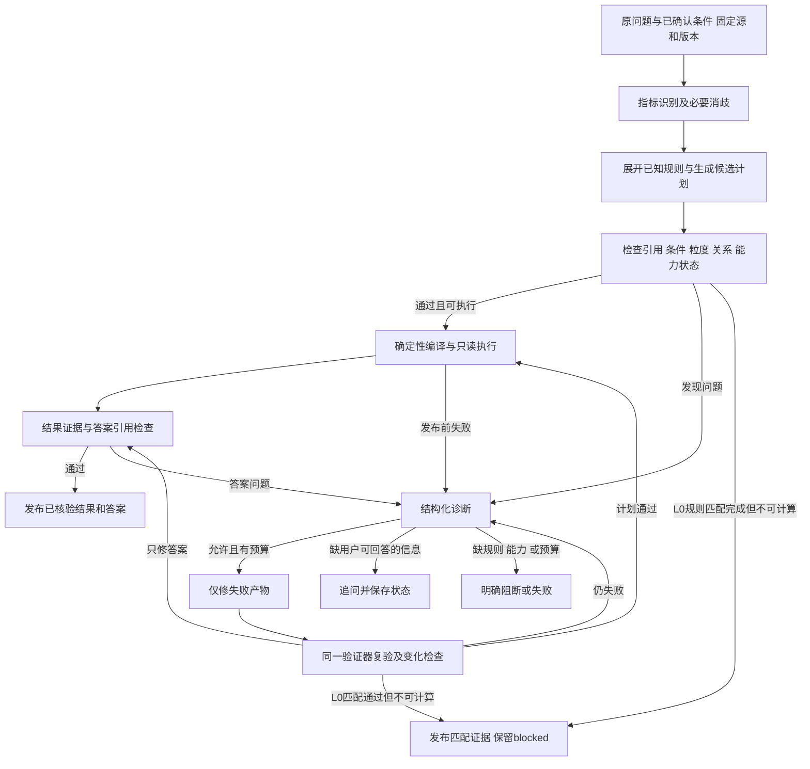

# 问答错误归因与有限自动修复：Pi 方案评估

初稿：2026-10-15；历史方案更新：2026-10-16；归档说明：2026-10-19。状态：保留为领域错误分类及 Pi 接入调研参考，**不再作为完整产品范围与执行契约**。当前有效方案为[完整产品设计 v3](metric-evaluation-design.md)及其[运行](evaluation-runtime-contract.md)、[评分](evaluation-scoring-contract.md)、[知识与观测](evaluation-knowledge-observability.md)契约。

下文“首期”“不新增管理平台”、旧恢复/重试、发布和首次正确率措辞均为历史提案，不能据此缩减已确认的完整工作台、对账恢复、长期证据和质量门。代码现状及开源版本描述对应 10 月 15–16 日审查时点。相关两轮仅核对代码、需求及官方资料，没有调用业务模型、安装依赖或改变运行服务。

## 1. 推荐决策

保留 **Pi Durable + Pi AI + 当前确定性领域服务**。在现有问数流程中增加“验证 → 结构化诊断 → 有预算的定向修复 → 复验”，正常成功路径不额外调用复查模型。先解决模型输出、Schema Linking 和答案引用错误，再扩展复杂语义诊断。

架构约束：优先使用 Pi 原生 generation、领域工具、扩展和持久任务能力承载上述流程；业务代码负责指标规则、验证器及必要的预算/资源适配。默认不改 Pi 上游核心，不自建第二套通用 Agent 循环、任务调度或持久化框架；只有确认公开扩展点无法满足具体需求时才评估最小改动，并记录原因。

这里的 ReAct 指模型依据工具结果继续行动。Pi 已有这种循环及 Reviewer 扩展示例；医学语义是否正确、哪些条件不可改、何时必须停止，仍由应用提供规则。本文的“归因”指问答链路的错误定位，不是解释医院指标升降的业务因果关系。

继承 [PRD F08、F09、9.1](PRD.md) 与[旧版 ReAct 设计](../../docs/ReAct自修复与异步架构方案.md)的条件保持、有限修复和发布边界；运行框架采用 Pi，容量使用新版默认 5、最高 10，不沿用旧方案的 LangGraph 运行时和旧并发数字。

## 2. 开源依据与取舍

本轮先用 Firecrawl Developer Index 做一次聚焦检索，返回了官方代码资料；其额度状态显示为负，后续改用可用网页检索核对官网和仓库。Pi 按本地固定提交 `550f1f3ecd75bf756ab3c379ca9503e808a6c6d1` 审查；LangGraph/WrenAI 在线资料是当日读取快照，不表示已测试最新依赖。

| 对象 | 已核实能力 | 采用方式与接入代价 |
| --- | --- | --- |
| [Pi Agent Core](https://github.com/earendil-works/pi/blob/550f1f3ecd75bf756ab3c379ca9503e808a6c6d1/packages/agent/README.md) / [Durable](https://github.com/earendil-works/pi/blob/550f1f3ecd75bf756ab3c379ca9503e808a6c6d1/packages/durable/README.md) | 工具结果回到模型继续处理；Durable 原生 generation/tool 闭环，Reviewer 示例可要求再次检查 | 继续使用现有 Pi。借鉴扩展方式，不再叠加第二套 Agent 运行时。当前业务尚未使用原生生成循环，接入不能省略网关、预算及共享限流适配 |
| [LangGraph SQL Agent](https://docs.langchain.com/oss/python/langgraph/sql-agent) | 专用节点强制读取结构、生成、检查、执行，错误反馈进入后续调用 | 借鉴显式验证关口与回退边。教程的 SQL checker 没有输入原问题与指标定义，不能作为医学语义裁判；示例数据库工具不宜直接复制到产品。增加整套框架会重复现有状态、模型和持久化职责 |
| [WrenAI 当前 core/wren](https://github.com/Canner/WrenAI/blob/main/core/wren/src/wren/skills_content/usage/SKILL.md) | 通过 dry-plan 区分语义模型规划失败与数据库执行失败，每次改一处并复验 | 借鉴分层定位及结构化语义模型。保留当前 DSL/Compiler；整体迁移需引入不同语义引擎、SQL 处理和数据依赖，成本高于当前需求 |

工程依据与限制：Pi 为 [MIT](../LICENSE)，已有本地源码、规范及测试示例，但 Durable 明示 Experimental，继续固定版本。[LangGraph 包配置](https://github.com/langchain-ai/langgraph/blob/main/libs/langgraph/pyproject.toml)为 MIT，增加 LangChain Core、Checkpoint、SDK 等依赖；官方有[持续发布记录](https://github.com/langchain-ai/langgraph/releases)和[状态/递归测试](https://github.com/langchain-ai/langgraph/blob/main/libs/langgraph/tests/test_pregel.py)。[Wren 当前包配置](https://github.com/Canner/WrenAI/blob/main/core/wren/pyproject.toml)标注 0.15.0、Beta、Apache-2.0，包含 SQLGlot、PyArrow 等依赖及测试开发配置；本轮未验证其自动修复覆盖率。仓库有测试不等于本项目集成已通过。

Wren 的执行成功后默认写入记忆、超时后简化 JOIN/增加过滤或 LIMIT 等策略不能直接作为本产品规则。正确性确认和用户条件保持仍按本项目 PRD 执行。

## 3. Pi 已有能力和当前接入缺口

| 能力 | 源码事实 | 对本项目的含义 |
| --- | --- | --- |
| ReAct 式循环 | [agent-loop.ts](../packages/agent/src/agent-loop.ts) 将工具结果写回上下文；参数校验/执行异常可以成为错误观察 | 具备再次修正的基础，是否修好仍需应用复验 |
| 前后钩子 | Agent Core 有 beforeToolCall、afterToolCall、finishTurn；Durable 有 generation/tool hooks | 可接诊断及复查，但不同包接口不能混用 |
| Reviewer 范例 | [28-reviewer.ts](../packages/durable/test/examples/28-reviewer.ts) 的 onYield 返回 continue 要求再检查 | 示例用 faux provider 和结束短语演示扩展，未提供可靠医学校验或业务次数预算 |
| 原生 Durable 工具循环 | [generation.ts](../packages/durable/src/harness/generation.ts) 已串联 generation、工具和后续 generation | 不需要在 Durable 内另套 Agent Core |
| 重试和终止 | 原生生成可重试暂态模型错误；Agent Core 的无条件 continue 可无限循环 | 网络重试、语义修复、任务恢复必须分别计数；框架默认值不能替代产品预算 |
| 当前业务 | [runtime.ts](../apps/medical-query/src/runtime.ts) 注册 medical-query.run 自定义任务；[model.ts](../apps/medical-query/src/model.ts) 直接调 Pi AI，maxRetries 为 0 | 目前未接原生 generation/tool 循环，不能说配置一个开关就已经具备完整反思 |

重要边界：[Durable 规范](https://github.com/earendil-works/pi/blob/550f1f3ecd75bf756ab3c379ca9503e808a6c6d1/packages/durable/docs/spec.md#L2692-L2701)规定部分 hook 普通异常记录后继续。不能靠 onYield/afterTools 抛错阻止错误结果发布；最终执行和交付必须读取持久化验证状态，并在领域入口再次核验。

实现顺序调整：先验证将现有领域函数注册为 Durable 原生工具、通过扩展请求复验的最小接入，并复用现有 ModelGateway、ResourcePool、任务文档与事件约束。公开能力适配通过后优先沿用原生循环；当前自定义任务可作为过渡，不继续扩展成独立通用框架。切换前验证共享限流、取消、用量、事件和恢复；hook 用于编排，最终校验与发布门仍在领域边界执行。此决策替代初稿中把原生循环默认列为后续可选项的顺序，不表示已经完成迁移。

## 4. 当前真正需要解决的问题

普通查询在 [pipeline.ts](../apps/medical-query/src/pipeline.ts) 中仅执行阶段允许一次重规划。其 catch 接住的范围比字段/编译错误宽，可能把基础设施错误也交给模型；JSON、length 等模型错误发生在该 catch 外。L0 是两次模型调用后验证引用，没有修复循环。

[Python 领域服务](../apps/medical-query/python/domain.py)已有错误码，但 [domain.ts](../apps/medical-query/src/domain.ts) 跨进程返回时只保留 message。[l0-knowledge.ts](../apps/medical-query/src/l0-knowledge.ts)验证引用合法性，尚未验证全部必要条件覆盖。因此当前“没有异常”不能等同于“口径完整”。

已有实测记录见 [L0 落库与评测](l0-linking-evaluation.md)：完整一轮 14 题有 9 题通过；失败包含输出截断和关系引用/形状错误。后续 GK23 单题检查又发现两个非空条件遗漏。两次版本不同，不能合并成当前版本正确率，也尚无自动修复增益数据。

优先调整生产契约：模型负责选指标、消歧及补参数；程序从已登记规则展开已知字段、关系和条件依赖。减少让模型重新抄写大量已知内容，可降低格式错误和遗漏机会。这个收益仍须通过实测确认。

## 5. 推荐调用链

图中的路径由程序控制。L0 修复仅回到 Linking 验证，再发布匹配证据，不进入编译或 SQL；正式结果发布后的执行故障直接标记不完整，不回退重查。答案阶段修复复用同一结果。

## 6. 诊断契约与可修范围

新增小型诊断记录，存入现有任务/证据，不建新的服务或知识库：`diagnostic_id、stage_id、attempt_id、code、path、expected、actual、evidence_refs、cause_status、target_stage、next_action、stop_reason`。源指纹和规则引用随任务关联。

`cause_status` 区分 confirmed、suspected、unknown：例如数据库报告列不存在，只能证实列引用失败，不能立即断言中文意图理解错了。LLM 可提出有依据的原因假设，程序决定是否允许动作，模型不得自行授予可修权限或改预算。

| 观测与分类 | 默认动作 | 保护边界 |
| --- | --- | --- |
| MODEL_OUTPUT_TRUNCATED | 失败节点输出紧凑结构；有预算时定向重生成 | 不拼接残缺 JSON；不无限加输出额度，不重跑已完成上游 |
| INVALID_JSON / INVALID_RESPONSE_SHAPE | 给出具体 schema 路径和错误，重生成失败产物 | 区分语法错误、根类型和字段形状；失败文本限制大小 |
| UNKNOWN_FIELD / INVALID_RELATION / INVALID_CODE_TYPE | 对照固定目录和规则，修正局部引用 | 不造表列、关系或值域；候选关系不能升级为已确认关系 |
| MISSING_REQUIRED_CONDITION / WRONG_GRAIN | 比对原文、确认项及结构化规则；确定唯一表达时程序补齐，否则模型提出局部候选后复验 | 保留条件作用域、人数/人次、去重键和分子分母，不把条件无脑合并到全局 WHERE |
| SQL_COMPILE_ERROR | 区分输入计划错误与编译器缺陷 | 前者修 DSL；后者停止并记开发问题，不让模型绕过编译器提交自由 SQL |
| TRANSIENT_PROVIDER_ERROR | 明确可重试的 429/网络/5xx 同输入有限重试 | 不改语义；不将鉴权错误、运行总超时归入可重试 |
| DB_EXECUTION_ERROR | 保留具体驱动码、阶段和执行状态；仅已明确可安全重试且尚未发布的错误可重试 | 不把所有异常转成重规划；不通过删除 JOIN/条件或隐式 LIMIT 降低问题要求 |
| ANSWER_REFERENCE_ERROR | 只修回答引用或返回明确标注的确定性数据摘要 | 不重跑 SQL，不编造单元格、单位或总体数字 |
| RULE_OR_BINDING_MISSING / UNSUPPORTED_OPERATOR | blocked；用户确能补充的问题才追问 | 不让用户承担内部技术错误，也不猜测正式口径 |
| SOURCE_VERSION_CHANGED / CANCELLED / DEADLINE_EXCEEDED | 停止当前运行，保留状态与证据 | 不偷偷换版本，不取消后继续修复 |
| 正常 0 行 | 正常空结果 | 不触发“修到有数据” |

验证报告按检查项记录 passed/failed/not_evaluated；未知含义或未覆盖语义不得补成通过。不增加无依据的置信度百分比。

## 7. 修复产物与业务语义保护

模型返回失败阶段的结构化候选及依据引用，不返回任意代码或绕过编译器的 SQL。首期可用完整的小型阶段对象；由程序计算前后差异，拒绝越界修改，无需先实现通用 JSON Patch 引擎。所有修复仍使用当前配置的 DeepSeek 角色模型；不默认每问增加独立“批评模型”。

保护的是用户原意和确认事实，不是第一次模型输出中的错误字段。比如“就诊日期”被误映射成创建日期，可以凭规则纠正物理字段；不能把用户的统计时间窗从一个月改成一年。固定项包含源/版本、明确指定的指标及定义版本、机构、人群、时间范围、统计对象、粒度和确认的排除条件。模糊候选允许依据新证据重新选择，已经确认的选择只能通过用户明确修改进入新修订。

每次变化记录产物前后指纹、修改路径、规则/原文依据与验证结果。修改映射作废下游计划/SQL/候选结果/答案；只修答案保留结果。正式数据或已核验答案一旦发布，不允许静默替换为另一次查询。旧尝试迟到事件不能覆盖当前尝试。

当前 data_result 在答案模型调用前发布；实施时需在同一次状态提交中冻结 SQL、参数、源/结果版本并记录发布标记，之后只允许基于这份结果修答案。候选 SQL 与正式结果要分开标识。确定性数据摘要若不能完整回答原问题，应明确答案未完成，不用保留表格来冒充整项任务成功。

GK23 的具体例子：`metrics.json` 中 `met.gk-23.numerator.conditions.all` 明确列出 `checked_in_at`、`called_at` 非空，两条来源标注为 document_derived。这足以在 Linking 阶段检出规则依赖遗漏；未来计划展开也必须保留其分子作用域。预约成功代码则标为 synthetic_test_design，只能按合成源约定使用。报到与叫诊配对仍待确认，补齐非空条件不代表可计算该指标，更不能把同一条件直接加入分母。生产规则检查不读取专项评测 gold。

规则展开同时检查表达能力：当前普通 DSL 的平铺条件不能代表任意嵌套条件树和分子/分母作用域。不能表达的规则保持 blocked，依赖齐全不自动升级为可执行。

## 8. 次数、时限与并发

以下为待实施配置建议，不代表当前已有这些配置。以 PRD 上限为边界，首期默认更保守；开启修复前先落实预算扣减和终止逻辑。

| 配置或约束 | 首期建议 |
| --- | --- |
| 自动产物修复总数 | 每个 turn 默认 1，可配置 0～2；格式、Linking、DSL、答案共享，不按阶段各领一份 |
| 答案修复 | 最多 1，计入总修复数 |
| 暂态重试 | 每个逻辑节点额外最多 1；与语义修复分别记账，仍受总调用和期限限制 |
| 主查询执行 | 每个 turn 最多 2 次实际执行尝试，暂态重试也计入；编译拒绝另记。L0 当前恒为 0；结果发布后禁止替代执行 |
| 总模型调用 | 建议先设每个 turn 最多 8 次，覆盖初次、补充理解、修复、诊断及暂态尝试；这是容量起点，需真实评测调整 |
| 时间 | 继承单次模型 120 秒、运行段 600 秒；修复不重置期限。等待用户结束当前运行段；跨段累计调用/修复预算 |
| 全局并发 | 沿用活动运行和 LLM 默认各 5、最高 10；所有模型角色、入口及修复共享现有池 |

修复次数在操作发起前由服务端扣减并持久化，失败也消耗预算；明确规则的常规展开不属于修复。重复提交或补充回答不能重置 turn 预算。修复留在原活动运行内，不重新 enqueue，不嵌套申请第二个活动名额，不并发试多个候选。退避期间释放模型名额，真实请求尚未退出则继续计占用。

当前 reply() 会新建 runId 并重建 progress，只保留若干 trace 数组；新增预算必须作为 turn 级状态显式保留，不能依赖 progress 透传。LLM 请求数在实际发出前检查并登记，排队取消不算已发请求；恢复遇到未知调用不能重新赠送一次额度。暂态节点身份不随 repair attempt 改变，格式/截断错误不能改名暂态来绕过修复上限。多个上限共同生效，不承诺每类额度都能用满；耗尽明确记录 budget_exhausted。

停止条件包括预算用尽、取消/期限到达、规则或版本失效、无新证据的相同产物与相同错误、修复越界。暂态故障允许的一次同输入重试不受语义重复检测误杀；重复检测主要阻止同一语义候选来回重写。候选虽变化但没有消除诊断时不得无限继续。

当前 Pi AI maxRetries 为 0。接入 Durable 原生 generation 时须明确单一重试责任层，限制其内置暂态重试，并接入同一计数与共享模型池，避免 SDK × 节点 × 流程的次数相乘。未知是否完成的外部调用不可盲目重放；沿用 interrupted 和回执核对边界。

## 9. 现有界面如何承载

复用当前左右侧栏和证据卡，不新增管理平台。左侧每次真实修复调用增加 attempt 卡，保留该次 system/user/输出，不覆盖第一次提示词。右侧同阶段显示“发现问题 → 依据 → 修改内容 → 复验结果”，明确是程序修复还是模型修复。

示例展示：“条件覆盖检查：遗漏两条非空要求；已补齐匹配依赖；关联配对规则未确认，仍不可计算”。普通正常查询保持简洁。只展示可核对的诊断和实际产物，不展示或编造模型内部思维链，也不把模型自评当质量分。

## 10. 实施范围与验证出口

| 批次 | 拟改位置与职责 | 完成条件 |
| --- | --- | --- |
| A：Pi 原生适配验证 | 将领域函数映射为 Durable 工具及扩展，复用任务文档和共享资源约束 | 不改上游核心；网关、预算、并发、取消、恢复和事件验证通过；具体缺口明确记录 |
| B：诊断与必要校验 | model/domain 保留稳定错误；应用类型记录诊断；l0-knowledge 展开有来源的依赖与作用域 | 能区分输出截断、格式、引用、条件遗漏、规则缺失、源漂移和基础设施错误；L0 阻断状态保持 |
| C：有限修复 | 原生循环调用受限领域工具，应用验证器与 turn 预算控制修复许可 | 只重跑目标阶段；共享预算；发布门、取消、重复失败和幂等规则落实 |
| D：证据与评测 | trace/web 在原卡片展示尝试；扩展现有业务评测适配 | 能复核改了什么、为何允许、是否通过；沿 Pi evals 对照与重复运行方式组织业务评测 |

最小故障集覆盖：length、非法 JSON/数组根、错字段、错类型代码、未知关系、复合键缺列、分子/分母作用域错、漏必要筛选、正常空集、缺规则、源漂移、429、总超时、取消、答案错误引用及重复错误。构造会让错误计划得到不同结果的合成数据，防止“SQL 可执行且碰巧相同”蒙混通过。

调度与发布门使用可控故障替身验证：三轮追问不重置累计预算、重复 reply 不重复扣减、第 8 次模型请求后不再发请求、暂态/修复交错不超额、正式数据发布后 SQL 次数不再增加、取消后不启动修复且真实退出才归还名额、正常空集零修复。模拟验证与真实模型成绩分别报告。

评测先验证程序契约，再固定模型、提示词、规则版本、业务库快照、独立 gold 及预算，对修复关闭/开启做配对比较；区分第一次通过和修复后通过，分别测并发 1/5/10。指标至少包含：故障定位准确性、可修故障恢复率、正常任务误改率、不可答误答率、条件保持、额外调用/Token、耗时 p50/p95、实际并发峰值和取消回收。真实模型有波动，关键对照需重复运行；单轮效果不作准确率承诺。

修复历史先留作候选案例。模型说已修好、SQL 执行成功、用户沉默或未点踩都不能自动晋升为正式经验；仅独立验证或业务确认后按源/版本复用。评测 gold 与在线检索/提示词继续隔离。

## 11. 本轮完成与边界

已核对旧 ReAct 方案、新 PRD、Pi Agent/Durable 源码及官方示例，审查当前 ModelGateway、普通/L0 流程、错误跨进程传递和并发接入点，并查阅 LangGraph/WrenAI 当前官方资料。进行了并行只读审查及方案交叉检查。

本轮仅新增设计文档并更新变更总结；未修改运行代码，未执行构建、业务测试、付费模型评测或上游测试。当前缺少在线条件覆盖验证和统一修复预算等能力仍然存在。本文的默认次数及接入顺序是设计建议，效果须在实施后用上述用例与真实模型报告验证。
