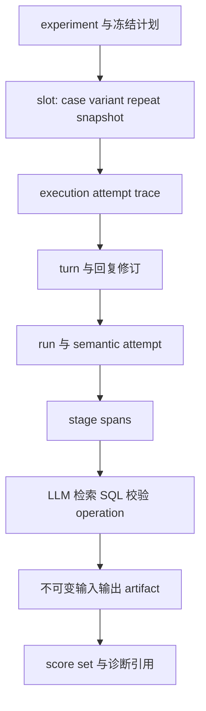

# 知识检索与可观测性契约

版本：v3 / 更新 2026-10-21。性质：完整产品目标契约；词法检索、来源过滤、冻结证据与手动删除已实现，实际覆盖见[验收记录](evaluation-acceptance-report.md)。遵循[总设计](metric-evaluation-design.md)以及用户确认：结构化规则决定计算、文档提供依据、全部完整产物保留至手动删除。运行和评分分别见[运行契约](evaluation-runtime-contract.md)、[评分契约](evaluation-scoring-contract.md)。

## 1. 知识的权威与检索的职责

SQLite 存储和 RAG 不是二选一。SQLite 保存物理数据、结构化知识及可索引元数据；检索负责为当前问题找到适用候选；审核后的语义规则决定口径。向量索引是可选派生物，不成为权威规则库。

| 知识对象 | 权威与用途 | 必需身份 |
| --- | --- | --- |
| 指标及计算规则 | 已确认公式、粒度、纳排、分子分母、代码及时间 | metric_id、definition_version、approval_status、有效期、来源引用 |
| 医院绑定 | 逻辑字段到物理表列、完整复合关联及适用机构 | binding_version、source_id、hospital_scope、schema_hash |
| 原文及解释 | 解释口径、消歧与提供证据；不自动覆盖规则 | document_id/version、内容 hash、出处定位、机构及有效期 |
| 表列目录 | 物理字段、类型、中文说明、业务域、别名 | catalog_version、实体 ID、来源与更新依据 |
| 已审核示例 | 辅助理解；独立声明是否给所有对照组使用 | example_id/version、审核记录、适用规则与拆分归属 |
| 检索索引 | 可重建候选召回结构 | index_manifest、语料 hash、切分/分词/embedding/reranker 版本 |

模型生成的新解释、能执行的 SQL、用户未点踩都不构成审核通过。生产规则检查不读取评测 gold。候选关系、合成约定和待确认口径继续带来源类别，不能在索引阶段悄悄晋升为正式事实。

## 2. 文档与索引生命周期

导入保留原始文件或规范化原文、内容 hash、页/段/表格定位和解析器版本；格式不支持或解析失败明确退回，不把缺内容文档标成已索引。增量更新创建新版本，不覆盖既有证据。

状态为 `imported → parsed → review_required → approved → indexed`，也可进入 `rejected/retired`。原文作为解释证据的审核，与将其转为可执行规则的审核分别记录；原文获准检索不意味着其中每个公式已完成医院绑定。结构化规则变更必须有显式审核记录、差异和适用时间。

索引构建先生成完整 manifest，校验条目数量、引用和语料 hash 后原子切换当前指针。普通版本更新时，在途实验继续读取已绑定版本；构建失败不污染旧索引。正式撤回不同于更新：涉及撤回资料的下一槽、追问、修复均停止新增执行，已经在途的候选也不得越过发布门。旧实验保留冻结资料及撤回说明，仅供历史复核，不能悄悄换新版本续跑；历史成绩不改写，相关发布资格标为待重评或撤销适用。

查询所需版本已被手动删除时返回 `knowledge_snapshot_unavailable`；禁止静默使用最新版本补位。多进程仅使用控制端发放的已冻结知识包，worker 不自行拉取当前知识。

## 3. 一次检索的完整调用链

1. 固定 `source_id/as_of/hospital_scope/knowledge_version` 与当前已确认问题条件；上一轮上下文只来自本会话。
2. 对精确指标编号、登记名称及别名进行确定性解析，再使用配置的候选检索策略；字面命中多个版本也必须按适用时间过滤。
3. 对目录元数据或文档先应用医院、来源、有效期、审核状态过滤，再召回。过期版本不得依靠较高相似度挤入候选。
4. 产生有限候选、原文引用和排序依据；按冻结上下文预算裁剪。候选列表、最终入模条目及被裁剪条目分别记录。
5. 对选中的指标确定性展开完整规则依赖、关系路径及复合键、代码类型、时间角色、单位和已知缺口。top-k 只限制候选数量，不能裁掉选定规则的必要依赖。
6. 验证后分流：唯一且足够→生成受约束计划；业务选择不唯一→澄清；规则/绑定不完整→有依据地阻断；目录外→说明范围；内部检索故障→系统错误，不伪装成业务不可答。
7. 将已验证知识包及来源引用传给 Pi 任务；规则、DSL、SQL、答案均引用相同版本。片段不能当作执行指令，更不能改变工具权限或读取 gold。

完整规则超出上下文预算时返回明确缺口或执行已登记的分步读取协议，并记录实际读取；不截断分母条件后继续计算。候选无命中时可按配置回退全目录，但保留回退原因及额外消耗，不能使错误率凭隐藏回退得到美化。

## 4. 检索策略与 RAG 决定

| 策略 | 必须提供的实现契约 | 用途与边界 |
| --- | --- | --- |
| `full_catalog` | 冻结完整目录输入与裁剪记录 | 作为真实全目录基线；超出模型上下文时记录不支持，不能丢字段后仍称完整 |
| `lexical` | 精确编号/别名、字段说明及文档全文检索；固定中文分词、排名和过滤版本 | 复用 SQLite 词法索引能力；中文不能假定默认分词天然足够，需以真实语料验证 |
| `hybrid` | 词法和向量候选融合、固定融合/重排方法及模型版本 | 提升语义改写召回；需额外 embedding、索引存储和构建记录 |

产品拟采用结构化规则展开和词法候选检索，当前完整目录保留为基线；从全目录切换到词法也必须经过验证，不能直接替换当前默认。混合检索是有明确输入/输出契约的策略扩展。词法和混合策略激活均须通过统一质量门：完整任务质量满足冻结阈值和非退化条件、严重违规为零、覆盖和证据充分。召回改善是选择策略的诊断证据，不能单独放行整题质量退化的方案。没有证据时不安装向量库，也不声称混合检索已被验证。

向量候选可先以适合单机的本地索引实现，但具体库在采用时核对版本、许可、中文能力和运行依赖；当前不预定额外向量服务。接入向量不能改变权威存储和证据引用协议。网络 embedding/reranker 经统一模型出口，本地 embedding 经 CPU 进程池，不能绕过资源控制。

L0 比较“全指标目录识别/词法候选识别/混合候选识别”，后续展开保持相同；facts 比较“全物理目录/词法元数据/混合元数据”，所有方案得到相同可用业务知识。不得只有检索组得到正确表或人工整理示例。

必报指标包括必要指标/字段/关系路径 recall、候选 precision、展开后的依赖完整率、无关上下文比例、最终正确率、文档引用正确性、无证据回答率；token、构建/查询费用、缓存冷热、排队及执行时延作为提示。向量相似度只称排序分数，不称医学或答案置信度。

## 5. 每次检索与观察的数据契约

| 记录 | 必需字段 |
| --- | --- |
| RetrievalRequest | operation_id、输入产物、source/hospital/as_of、语料及策略版本、过滤、top-k、上下文预算 |
| RetrievalReceipt | 实际策略、每路候选 ID/排序/分数、融合/重排、入模 ID、规则展开新增项、裁剪/回退、时间及用量 |
| EvidenceRef | artifact_id、document/metric/binding ID 和版本、页/段/JSON 路径、内容 hash、支持的声明 |
| KnowledgeDecision | 选择/歧义/无命中/缺规则/系统错误、检查项、缺口及可回答范围 |

检索器接口固定版本、输入 schema、输出 schema、所需资源、最大候选/内容边界和取消语义。新增策略由受信任代码注册；配置只选择已登记实现，不执行任意脚本。策略错误、无命中和无权限/不适用来源是不同状态。

## 6. Trace 身份与层级

实验可能运行多天，用 `experiment_id` 归组，不创建覆盖整场实验的巨大 span。每个 slot 执行尝试建立独立 trace，多轮用户回复、分支重放及恢复通过 links 和稳定身份关联。

span 记录 `trace_id/span_id/parent_span_id`、experiment/slot/attempt/turn/run/operation 身份、source/执行包版本、开始/结束/状态和事件序号。阶段因实际代码边界产生；不能将一次混合调用事后编造为单独测量的编译和执行时间。

模型请求还包括逻辑角色、配置模型名、可取得的实际返回模型名/版本、参数、完整消息产物引用、供应商请求 ID、finish_reason、实际用量、价格表版本及未知标记。网关只提供 alias 时标 `provider_revision_unverified`，报告限制精确同模型复现的声明。

错误保留结构化 `origin/code/retryable/phase/operation_id` 和原始诊断引用；展示文案单独本地化。发生 SQL 执行错误不能直接归因为用户意图理解错误。日志和产物不记录 API key、Authorization 或连接凭据。

## 7. 持久化与完整性

控制进程在发送前持久化调用意图和输入引用；收到结果后先原子写完整内容产物（临时文件、完成后发布 hash 引用），再提交引用、校验/用量及状态。SQLite 事务不跨越模型或 worker 外部调用。悬空临时文件不属于有效产物；恢复需对账，不能将没有正文的 completed 回执当完整观察。

流式事件带递增 `event_seq`，按有界批次落盘，完成/取消/错误时冲刷已收到内容；记录 `last_durable_seq`、收到的终止回执及内容 hash。提交后才向工作台确认该事件已持久化。断电可能丢失尚未持久化的增量，因此明确区分：

| completeness | 含义与可用结论 |
| --- | --- |
| complete | 必需事件、产物及终态检查全部存在，可以按对应档位重评 |
| partial | 留存部分流/阶段证据；可评价已证明的事实，不能补造完整答案或根因 |
| unresolved | 请求可能发生，响应/计费/终态无法确认；进入对账 |
| artifact_deleted | 用户已删除必要内容；保留摘要及删除事实，不能宣称完整重放 |

正文流完整与评分必需证据完整分别标记：少量展示增量丢失但完整终态正文已落盘，可以重评分；真正缺必需终态结果时不能判完整通过。已有充分证据仍可重评必要条件失败或产品未交付，其他检查保留未评。已明确的产品超时/失败仍保留分母，不能用 trace 不完整将其洗掉。

列表查询只读摘要索引，使用稳定排序键和游标分页；详情按 artifact_id 加载。控制台实时事件使用可恢复游标，断线后补读已提交事件；客户端重复收到事件按身份去重，不依赖流推送来计算权威总分。

## 8. 产物谱系、保留与删除

产物记录类型/schema_version、hash、字节数、创建事件、parent_artifact_ids、执行/知识/源版本及可见级别。修复创建新产物和 `supersedes` 关系，不覆盖首次候选；过时结果保留为 stale，禁止升格为当前发布。完整 SQL 结果用于评分，页面截断只影响展示并标记行数。

存储采用单机 SQLite 元数据和本地按内容寻址的产物目录。相同冻结目录和提示词可以复用物理内容，但每次调用仍有独立引用与接收记录。索引是派生读模型，损坏可由原记录重建；不能把它当唯一证据来源。

全部完整产物保留至用户手动删除，不做 TTL 或自动清理。工作台显示总量、按实验用量、共享引用及可用空间；空间不足时停止接收会产生新产物的工作，并报告 `storage_capacity_exhausted`。在途写入失败不得显示保存成功，也不自动删除旧实验腾空间。

删除前给出引用影响清单，明确实验/基线/发布证据是否因此无法重评；删除行为保留主体、时间、范围、原因及 tombstone。共享 blob 只有无保留引用时才可物理删除；涉及其他实验需显式纳入删除范围，不因删除一个实验破坏另一个。不能通过摘要再造已删原文。

## 9. 观测指标与报告边界

运行指标：按类别/实验/方案区分排队深度与时长、已派发/实际在途/未知调用、实际峰值、调度份额、退避与 429、暂停/取消收尾、worker 重启、SQLite 等待、事件积压和存储空间。

耗时分解为接收→排队→资源准入→实际执行→持久化→验证→发布；并行 span 不直接相加当端到端耗时。用实际时钟区间和资源回执，无法测量的项为 null。工作台能从汇总异常下钻到受影响的实验/slot/operation。

用量区分产品、修复、评测 judge、索引 embedding；本地结果缓存命中不等于新模型采样，供应商 prompt cache 也不等于复用旧答案。独立重复禁用完整答案缓存；供应商缓存状态作为实验条件记录。提供商未返回用量或价格未知时保留 unknown/null，可能费用不能记零。

耗时与费用完整展示、对照并提示，不单独阻止质量合格配置发布。运行超时、限额违反等导致任务失败的实际结果仍影响质量；两者不能混淆。

## 10. 开源采用与依赖决定

| 项目 | 采用方式 | 不采用部分及原因 |
| --- | --- | --- |
| Pi Durable / Pi AI | 任务身份、持久提交、实际调用及取消边界向统一观察适配 | 不改核心；generation 的恢复语义由应用适配确认 |
| OpenTelemetry | 使用 trace/span/link 标准和可选 OTLP 导出，字段映射版本化 | 外部查看器不接管本地任务与评分台账；未配置导出时产品仍完整可用 |
| Langfuse | 借用 generation/retriever/tool/evaluator 分类；可配置外部查看器适配 | 默认不启动其平台：PostgreSQL、ClickHouse、Redis、对象存储等超出当前本地依赖；不复制其 runner |
| Promptfoo | 借用 trace 与结果关联、实验对照、恢复时冻结运行选项等契约；可导出结果供查看 | 不并列运行其调度器/重试和答案缓存，避免绕开共享额度及改变重复语义 |
| WrenAI | 借用结构化语义与可重建派生索引分离 | 不迁移其完整 Python/语义引擎栈；既有规则资产和 Pi 保留 |

原生工作台消费本地查询投影及分数；导出器故障显示积压和失败，不改变原始分数或阻塞已经可保存的本地观测。手动删除本地记录不会假称同步删除外部已导出的副本；是否向外部发送由显式配置决定。本轮未配置任何外发。

来源：[WrenAI memory](https://github.com/Canner/WrenAI/blob/055830d786dbf9d2905e0f1095f18e889222a530/docs/core/concepts/memory_system.md)、[Langfuse observation types](https://langfuse.com/docs/observability/features/observation-types)、[Langfuse OTel 实验](https://langfuse.com/docs/evaluation/experiments/experiments-via-opentelemetry)、[Promptfoo tracing](https://www.promptfoo.dev/docs/tracing/)。具体许可、维护和部署证据见[审查记录](evaluation-product-review.md)与[开源调研](evaluation-research-v2.md)；不把上游测试存在等同本机测试通过。

## 11. 验收证据

| 场景 | 必须证明 |
| --- | --- |
| 文档版本冲突、错误医院、过期材料 | 不进入适用知识包；规则与文档冲突明确暴露，不自动选择有利片段 |
| 同义问法、无命中、候选过多、必要依赖超预算 | 召回/回退/澄清或阻断有记录，条件不被截掉后继续计算 |
| 索引构建失败与在途更新 | 老实验读原版本，新指针只指向完整可验证索引 |
| 模型调用中杀进程、终态正文已落盘但提交未完成 | 完整性标记准确，对账不重发未知调用，孤立产物不冒充成功 |
| 修复和迟到回执 | 能找到修复前后与父产物，旧尝试不覆盖当前结果 |
| 事件重复/断线重连/索引重建 | 权威结果不重复，游标补读一致，汇总不依赖前端临时内存 |
| 跨实验共享 blob 删除、空间耗尽 | 无静默误删，删除影响可查，容量不足背压且在途失败明确 |
| 冷热缓存与外部 exporter 失败 | 对照条件可查，缓存不伪装独立重复，本地台账仍完整 |

这些是完整验收要求；本轮词法候选及证据产物已接入真实运行，未安装向量库或外部观测平台。文件导入审核全流程、混合召回和外部 OTLP 导出尚无实现验收，不将可扩展契约写成现有功能；逐项证据见验收记录。
