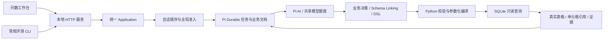

# Pi 智能问数实施记录

更新：2026-10-15。需求基线为 [PRD v0.3](PRD.md)，代码位于 `apps/medical-query`。本批交付 M0 与 M1 的基础查询子集，不代表 M1 全部或 P0 已验收。

## 本批结果与调用链

本地工作台连接两家模拟医院的合成数据，提交问题、补充追问、刷新恢复、停止任务，并查看真实结果及查询依据。首页按最新截图收敛为简洁问数页，暂时隐藏数据源信息与切换入口；后台仍按会话绑定数据源。决策与结果引用选择均已接入现有项目提供的 DeepSeek 网关配置；密钥通过本地文件引用读取，不复制到源码、报告或业务任务。

模型决策在一次请求中完成意图判断、当前源的表列匹配和基础计划。需要追问时结束该运行段，保留待答状态；清晰问题执行确定性编译与 SQL，再由回答模型选择真实单元格，最终数值由服务端生成。正常空集直接返回；编译或执行失败最多进行一次针对错误的计划修复。暂未实现网关自动重试。

## 模块设计与验证范围

| 模块 | 已交付及取舍 | 已进行的验证 |
| --- | --- | --- |
| 运行层 | Pi Durable 的 session 索引、conversation 文档与自定义 Task；业务意图持久化，外部 I/O 在事务之外；不用 coding-agent 的 shell/文件工具 | 真实 SQLite 存储、重复请求、同会话顺序、队列容量、追问版本、取消竞争、运行/排队超时、SIGKILL 恢复、跨进程占用锁 |
| 并发 | 活动运行与模型请求分别默认 5、最高 10，允许 1 对照；评测子额度不超过总额；在线优先，不抢占已开始请求 | 1/5/10 限额；队列取消不发请求；真实工作退出才释放额度；评测占满子额度时在线可用剩余容量 |
| 模型 | Pi AI 的兼容接口连接现有网关；默认 `tencent-deepseek-v4-flash`；决策必须为 DeepSeek 系列；不向网关发送不支持的 `thinking` 扩展参数；记录实际 system/user 文本与调用生命周期 | 实际模型与 SQL 闭环；用量累计跨追问保留；价格未知记 `null`；原始错误响应及凭据不回显；本轮提示词/trace 离线与页面验证见下节 |
| 领域查询 | Python 标准库 sqlite3，无额外 Python 依赖；注册数据源、只读独立连接、参数化过滤、已确认关系、去重与基础聚合 | 20 项领域测试，覆盖复合关系、LEFT JOIN、错误字段、参数注入样例、截断、超时、30 次并行独立查询 |
| 问数链路 | 固定源版本，继承最近三轮已完成任务的条件与计划；不把旧数值作为实时答案；最多三轮业务补充 | 真实 SQLite 配合本地模型替身，验证追问不执行 SQL、最多一次修复、空集不重试、回答失败保留数据、无效单元格不发布 |
| 工作台 | 简洁首页、黑白主题、按源会话、状态轮询、追问表单与已补充记录、结果分页；桌面提问后自动展开提示词/逐轮证据，左右独立调宽 | 前批桌面真实查询：医院 A 年龄 ≥65 为 3 人，医院 B 为 2 人；医院 B 追问后为 1 人且刷新保留；本次界面验证见下节 |
| 评测 | 默认通过 HTTP 使用同一服务；`--standalone` 基线独占主服务锁，使用隔离会话库；gold 不进入产品输入 | HTTP 真实模型验通；服务运行时独立模式拒绝启动；类型敏感行多重集、参数解析、HTTP 协议与快照验证有离线测试；三档实测见 [基线报告](evaluation-baseline.md) |

依赖固定为 Pi 工作区 `1.2.0` 和 `p-queue 10.0.0`；上游提交 `550f1f3ecd75bf756ab3c379ca9503e808a6c6d1`。Pi Durable 为实验性能力，本批通过实际恢复测试验证已使用的接口，后续升级需重跑这些边界。p-queue 仅控制进程内资源准入，业务队列和会话顺序由产品状态决定。

## 首页与主题调整（2026-10-15）

本节保留上一轮交付记录；其中“提问后证据默认收起”的行为已由下节双栏交互覆盖，空白首页仍收起两侧。

目标是按用户提供的初始页面截图降低首页信息密度。保留 Pi 品牌、居中提问引导、一句可填入输入框的自然语言示例和底部输入框；数据源目录暂时隐藏，证据栏默认收起，开始对话后才显示入口。问答记录、历史评测和截图中的评分不在本次范围。

沿用原生 HTML/CSS/JavaScript，没有新增依赖。`index.html` 在加载样式前恢复主题；`app.js` 切换 `data-theme` 并保存偏好；`styles.css` 用变量覆盖正文、表格、追问、错误和证据样式。默认浅色，深色采用中性黑灰，青绿色仅用于强调。窄屏证据栏覆盖显示，可由关闭按钮、遮罩及 Escape 收起。

数据调用链继续为目录加载 → 原会话恢复 → 提交/补充 → 后端状态轮询 → 结果与证据。恢复完成前禁止提交；不可用的历史源不会静默改为默认源，新会话才允许选取首个可用源。输入框保持 Enter 发送、Shift + Enter 换行及中文输入法保护，文本按内容自动增高。这里只调整页面呈现，仍显示服务端实际进展，未新增答案逐字流或完整结果流。

本次应用与根仓库检查通过。浏览器验证黑白切换及刷新保留、默认隐藏、示例填入、输入增高、新会话复位；实际 CSS 视口 400×843 与 1400×900 无页面横向溢出，窄屏证据可循环焦点、Escape 关闭并恢复焦点，桌面证据并排。实际通过页面查询年龄 ≥65 患者，模拟医院 A 返回 3 人，表格、SQL 和刷新恢复正常。黑白首页截图存于本地忽略目录 `apps/medical-query/.local/ui-checks/`。此前通过的 61 项目标测试与真实模型基线属于上一批验证，本轮未重跑完整追问、取消或并发回归；未做真机软键盘测试。

## 实际提示词、逐轮证据与可调分栏（2026-10-15）

本轮保留空白首页，调整提问后的工作区。桌面新提交被服务端接受后自动展开左侧提示词和右侧证据；用户随后收起面板，轮询不会把它重新打开。新问题将左栏切换到本轮记录，也可通过左栏问题选择器或右侧历史问题卡片查看对应提示词。底部输入器跨工作区显示，三栏内容分别滚动。

左栏按真实模型调用逐项显示问题理解/字段匹配、答案生成角色以及模型、状态和完成耗时，system/user 文本放入可选择复制的只读文本域。右栏每个问题一张卡片，按实际调用顺序记录四类阶段：读取数据结构与语义；理解问题、匹配字段与制定计划；校验编译并执行查询；答案生成。追问、修复及失败可以增加或提前结束记录，不为了凑固定步骤补造阶段、置信度或耗时。无新 trace 的旧记录明确提示未采集。

调用链为 `ModelGateway` 生成与发送同一份 system/user 文本 → `pipeline` 发布调用开始与阶段进度 → `QueryRuntime` 持久化 progress/result 和退出状态 → `publicTurn` 输出 `model_calls`/`stages` → 浏览器轮询并绘制卡片。调用记录包含独立 ID、模型角色、开始时间、状态、耗时和已有用量；阶段耗时覆盖该阶段完整操作及其内部资源等待，不是模型独占耗时。认证参数独立交给 SDK，不进入记录。提示词和阶段不塞入业务 evidence，后续问题的 prior 只继承原有问题、补充和查询依据，避免 trace 被递归回灌。

布局采用原生 CSS Grid 的“左栏/分隔条/主栏/分隔条/右栏”，以 Pointer Events 与指针捕获实现拖拽；左右分别保存宽度，限定中央阅读空间。分隔条支持方向键、Home/End、Enter，具有名称、控制目标和值域；开合状态按会话保存，宽度按当前视口约束恢复。宽度不超过 1100px 时采用单侧互斥抽屉；遮罩、关闭按钮和 Escape 可关闭，背景暂时不可交互。内容未变化时不重建卡片，选中文本时延后替换，文本域选区、展开状态及滚动位置在更新时保留；这仍是 HTTP 轮询界面，不是答案逐字流。

技术选型已优先通过 Firecrawl 调研。[Split Grid 官方文档](https://github.com/nathancahill/split/tree/master/packages/split-grid)提供零运行依赖的 Grid 拖拽工具，[包配置](https://github.com/nathancahill/split/blob/master/packages/split-grid/package.json)标明 MIT 与 Jest 命令；抓取的[仓库页面](https://github.com/nathancahill/split)显示最近主分支提交为 2023-07-04。本轮未安装或运行其测试，也未据此判断其当前测试覆盖率。该库仍需应用实现键盘、ARIA、折叠和窄屏状态；两个拖条直接复用现有 Grid 的接入面更小，因此不新增依赖，不建设通用分栏框架。交互参照 [WAI Window Splitter](https://www.w3.org/WAI/ARIA/apg/patterns/windowsplitter/) 和 [MDN Pointer Capture](https://developer.mozilla.org/en-US/docs/Web/API/Element/setPointerCapture)；引用这些规范不等于已完成无障碍验收。

最终改动已通过仓库根 `npm run check`、应用格式与类型检查。后端 23 项目标离线测试通过；补充崩溃记录断言后重跑 runtime 12 项通过。浏览器实际向模型提交两次问题：模拟医院 A 年龄 ≥65 患者为 3 人，女性患者为 2 人；已检查双栏自动开启、每次新问题对应真实提示词、多轮卡片、左栏 300→440 与右栏 340→540 独立拖拽、右栏键盘 540→560 调宽。

手动收起左栏后，轮询不会重开；刷新保留该收起状态及右栏 560px，重新展开左栏恢复 440px。实际 CSS 视口 400×703 无页面横向溢出，左右抽屉互斥。修正折叠卡片后代干扰焦点判断后，两侧均通过从关闭按钮 Shift+Tab 到末项、再 Tab 回关闭按钮的循环检查；Escape 和可见遮罩关闭均返回入口焦点，并恢复背景交互。黑白主题下的卡片、文本域与分栏已检查，桌面 1167px 宽仍保留中央 420px 阅读宽度且无横向溢出；较长 DSL 默认折叠，实际 SQL 与结果继续直接展示。黑色截图存于 `apps/medical-query/.local/ui-checks/trace-panels-dark-preview.jpg`，仅裁去了截图工具附带的画面外空白。未做真机软键盘测试，本轮没有重跑完整 1/5/10 模型质量基线。

## L0 原始事实落库与独立匹配评测（2026-10-15）

新增一个 `l0_mock` 合成数据源（26 表、216 列、94 行），保留原医院 A/B。47 项定义继续由原 JSON 提供；两次共享 DeepSeek 调用分别做指标识别与按需知识匹配，保存实际提示词、字段、复合关系、候选关系和缺口。当前 L0 固定返回不可计算，不进入 SQL；45 项引擎/本院映射缺口及 2 项规则来源缺口不解除。新 14 题独立 gold 不进入产品输入，并按结构匹配而非拒答状态计分。详细设计、来源、调用链、验证进度和边界见 [L0 落库与评测记录](l0-linking-evaluation.md)。

## 数据与运行边界（基础查询）

业务 SQLite、语义 JSON、源清单、运行 SQLite 与评测报告分开保存。两个离线夹具各有三张表，故意使用不同表列名和代码；包含重复就诊、疑似诊断、撤销记录与日期边界。版本标识为数据库文件和语义文件的内容哈希。当前针对冻结夹具验证，运行或评测中不能更新这些文件；大型库与 WAL 在线更新的一致快照尚未实现。

工作台固定演示时间为 `2026-10-15T12:00:00+08:00`；评测可以指定固定时间。它是合成场景的时间锚点，不是生产系统的当前时间策略。

普通评测复用正在运行的本机服务，因此评测、网页和全部模型角色共享实际额度。独立基线通过与主服务相同的存储锁禁止双实例；配置不同数据目录会构成独立实例，本批没有跨实例或跨机器配额协调。外部调用最多等待到真正完成或取消退出；停止正在运行的任务可能需要等待底层请求退出。

重启保留待答和已接收的排队意图，重建进程内容量。异常退出时尚在运行的请求标记中断，不自动重放不确定的外部调用；不承诺外部请求严格执行一次。损坏锁文件或异常遗留的回收标记会拒绝启动，需要先确认无活跃实例再处理。

## 明确未完成的需求

数据源配置/构建/发布页面、映射与术语维护、基础指标中心、SourceBundle 发布协议、完整结果分块传输与导出、反馈处理及评测页面仍待实施。当前最多返回 200 行，分页仅分页已取得的数据；超过上限会明确标为截断，总数未知，不冒充完整结果。

领域 DSL 当前不支持 OR、EXISTS、窗口计算、同表多别名、比率与时序算子。普通查询仍使用全量小目录；L0 已采用指标目录识别后投影知识及独立关系/代码 gold，但大规模检索、更多等价路径和真实医院评测仍需后续补齐。原 11 题查询冒烟集与新增 14 题 Linking 集均为合成验证，不能用其通过率表示真实医疗语义准确率。

接下来按 PRD M1 补齐数据源接入、语义构建与映射维护，再扩充 Linking 标注及查询能力；M2 补齐完整结果、反馈和评测视图。每个模块在同一应用入口验收，保持共享并发约束。
