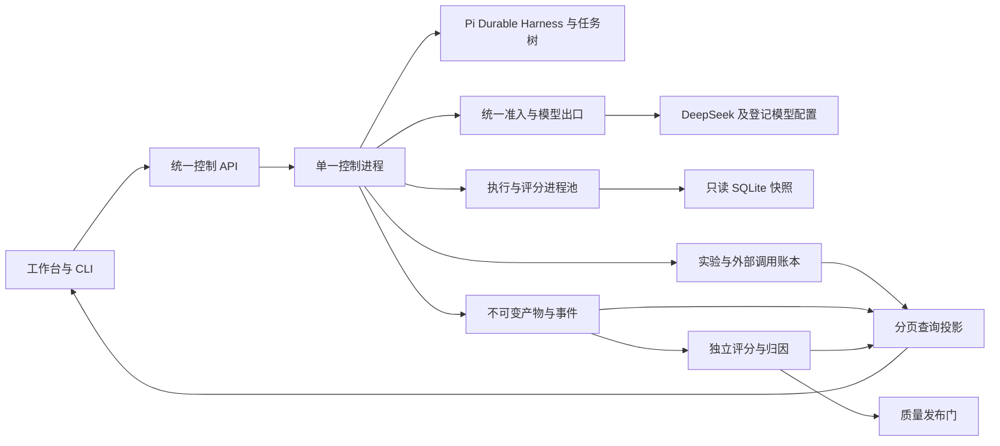

# Pi 智能问数：完整产品化评测设计 v3

更新：2026-10-19。用户已通过 grilling 确认九项产品决策及完整共同理解。本文件替代 v2 的缩减范围设计，连同下列三份契约构成完整产品方案。当前状态为**已实施并取得部分离线验收证据，完整产品验收进行中**；逐项结果见[验收记录](evaluation-acceptance-report.md)。设计要求保持不变，不以测试替身或接口存在替代真实质量及完整用户流程验收。

| 文档 | 负责内容 |
| --- | --- |
| 本文 | 产品边界、模块、调用链、对象与接口、工作台、完整验收矩阵 |
| [运行与并发契约](evaluation-runtime-contract.md) | Pi 拓扑、状态机、跨进程共享额度、公平调度、暂停/取消/恢复 |
| [评分、对照与归因契约](evaluation-scoring-contract.md) | 数据集、gold、评分扩展、对比、反例、修复归因及质量发布门 |
| [知识检索与观测契约](evaluation-knowledge-observability.md) | 语义层、文档依据、检索策略、完整 trace、产物保留与导出 |

依据：[grilling 决策与审查](evaluation-product-review.md)、[开源研究](evaluation-research-v2.md)、[现有数据底座](l0-benchmark-data.md)。旧[归因修复方案](diagnosis-repair-design.md)保留领域规则参考；与本版冲突的恢复、发布、分母和产品范围以 v3 为准。

## 1. 已确认的产品目标

产品提供完整评测工作台及同等能力的 API/CLI：可创建多个实验，对模型、提示词、知识检索、流程与修复策略开展对照；运行可恢复、证据可追踪、评分可复查、错误可归因，质量结果约束默认配置发布。

| 决策 | 完整要求 |
| --- | --- |
| 架构与部署 | Pi 原生优先，不大改核心；单机多进程、明确所有权与隔离，不宣称已支持多机器 |
| 并发与公平 | 活动任务和 LLM 并发默认 5、上限 10，所有入口受控；在线优先、评测保底、实验间公平、空闲额度借用 |
| 产品入口 | 原生工作台＋API＋CLI，共享实验、状态、分数和发布记录 |
| 故障恢复 | 确定未完成工作可恢复；未知调用先对账，显式续跑并保留原尝试和可能费用 |
| 知识 | 已审核结构化规则决定计算；制度/指标原文提供出处；检索策略按对照证据选择 |
| 数值发布 | 主对话只发布通过必要验证的数值；候选产物仅供工作台调试；纠正显式留版本 |
| 产物保留 | 全部完整产物保留至用户手动删除，不自动过期；容量不足背压，不静默删证据 |
| 发布门 | 质量为主，严重违规强制阻断；耗时与费用作提示，不另设性能/费用放行门 |

运行期限、调用次数和队列上限仍必须执行，防止任务失控；由此实际发生的失败计入质量。人工更改质量政策创建新版本，不能为某个已见结果偷偷修改门槛。

## 2. 设计起点与能力声明

当前已有 Pi Durable/Pi AI、HTTP 问答与回复、SQLite 领域服务、同会话串行、共享资源池、提示词与证据侧栏，以及独立 gold 的评测基础。新数据包有 106 张表、136,742 行和 136 题；其中 95 预期阻断、40 应答、1 澄清。持久化评测控制服务已接通新包并完成导入校验；旧 CLI 入口已转到统一控制 API，历史 11/14 题成绩保持原含义，不充当新包实测结果。

L0 路径在指标候选识别后确定性展开登记规则；facts 路径按配置读取完整物理目录或词法候选及必要关联。当前开发运行默认词法召回，避免 106 表完整目录超出已设预算；40 道事实题所需表的纯召回覆盖 40/40，但该证据不能替代完整问答质量或生产发布资格。报告分别命名“指标选择与绑定投影”和“全目录/检索下的业务问数”。80 张支撑表目前主要为干扰项，不能把规模直接当业务覆盖。

47 项正式指标当前完整验收 gold 为 0/47。平台完成不意味着这些正式指标已完成；正式口径/医院绑定和合成约定分别标识。每个指标记录定义、绑定、引擎、gold、已测、通过六种状态；缺口不得通过改成预期拒答来隐藏。

完整产品必须支持全部下述契约并通过验收；技术实现有依赖顺序，但不把恢复、观测、对比或工作台删成所谓首期边界。真实医院验收缺少的数据与确认记录仍如实标为未具备，不能从公开资料或模型推断替代。

## 3. 进程拓扑与 Pi 复用

一个控制进程独占一个 Pi Harness/Session 和调度权；API 是其命令/查询入口，不自建第二个 Application。worker 负责受控的只读查询、编译/校验、索引构建和评分等工作，不直接连接模型，也不自行领取另一份 5/10 额度。

复用 Pi 的 `defineTask`、版本迁移、阶段 checkpoint、`runtime.commit`、普通 owned 子任务、取消、inspect 和 watch。实验任务拥有各题的独立执行会话，取消沿 ownership 树传播；不将这些必需工作标成 background 来逃避收尾。

Pi scheduler 没有本业务的数字并发限制，也不支持多个 Harness 同时占有同一 Session。原生 generation 的 request checkpoint 可能重发；部分 wait/submit 操作会隐式恢复调度。恢复对账必须先于这些操作，普通 hook 抛异常不能作为唯一准入防线。模型出口和调用账本位于应用层，不修改上游恢复语义。

原生 generation/tool 接入须经过同一出口并通过恢复/取消/完整性测试。保留当前 custom Durable 任务作为合法接入形式，不能为使用某个原生 API 而削弱约束。多进程的目的包括可控终止与 CPU 隔离，不声称增加进程就能增加账号额度。

## 4. 模块边界与可扩展接口

| 模块 | 输入→输出 | 扩展约束 |
| --- | --- | --- |
| DatasetRegistry | 公共问题＋私有 gold＋覆盖声明→不可变数据集版本 | schema 校验、family 拆分、来源和独立复核；gold 不传产品 |
| ExperimentService | 数据集、方案、重复、快照、协议→冻结计划与槽位 | 所有入口同幂等命令、状态与修订号 |
| PiExecutionAdapter | 槽位＋运行配置→实际业务 turn/run | 与在线问答共用领域入口、验证及发布逻辑 |
| AdmissionController / ModelGateway | 类别/实验/角色/账号资源请求→准入与回执 | 全局预算、公平、未知账本；worker 不直接请求提供商 |
| KnowledgeProvider / Retriever | 版本化知识与问题→候选和完整适用规则包 | 权威/索引分离、来源过滤、结果 schema、取消和资源声明 |
| ObservationStore | 事件/产物/回执→不可变谱系与查询投影 | 单写者、稳定身份、完整性、手动删除和索引重建 |
| ScoringService | 冻结观察＋私有 gold＋评分器版本→独立 score set | 不修改产物、不调用产品函数造 gold、不覆盖旧分数 |
| DiagnosisService | 检查失败＋产物依赖→已证实/疑似/未知原因与传播 | 引用具体检查证据，不把相关性或模型自评当根因证明 |
| Comparison / ReleaseService | 同协议分数与允许差异→可比性、质量决策 | 缺配对/版本漂移阻止不成立结论；成本时延提示 |

扩展项由受信任应用代码登记 `id/version/input_schema/output_schema/capabilities/resource_policy`；配置只能选择已登记实现。新增 scorer、检索器或指标算子不改变实验身份与观察协议；语义改变提升版本，不用同名覆盖旧实现。不建立可任意执行代码的通用插件平台。

## 5. 权威对象、身份与存储

| 对象 | 关键身份与内容 | 不变量 |
| --- | --- | --- |
| DatasetVersion | case/family/split/track、问题、gold、覆盖及出处 | 发布版本不可原地改题；公开输入仍可导出原四字段格式 |
| ExecutionBundle | 应用源码 hash、Pi 基线、依赖锁、提示词、工具/编译器、模型配置、知识/源快照、预算/调度版本 | 包含未提交源码，不能仅记 Git HEAD；不保存密钥值 |
| Variant | execution_bundle_id＋允许变化的实验因素 | 创建时解析角色模型和策略，不读取可变“当前默认” |
| ExperimentPlan | dataset、variants、snapshots、repeats、评分档位、随机顺序、质量政策 | 开始后不可扩大题集或换政策；变化派生新实验 |
| Slot | experiment×case×variant×repeat×snapshot 的唯一键 | 等价派发不产生第二个槽位；全部计划槽可盘点 |
| ExecutionAttempt / Operation | 运行/修复/传输重试、requestId、worker incarnation、调用状态 | 重试、修复、用户回复、独立重复不是同一概念 |
| Artifact / Event | 内容 hash、类型、schema、父产物、序号、版本、完整性 | 修复和迟到内容保留原身份；不能覆盖原始内容 |
| ScoreSet / Adjudication | 观察/gold/scorer/judge 版本、检查结果、裁定理由 | 重评产生新版本，原始观察和历史判定不改写 |
| ReleaseDecision | 精确配置 hash、报告/政策、证据摘要、判定与时间 | 通过评价不等于已激活；默认指针单独原子更新并记录 |

权威控制状态使用应用级持久文档；未知外部调用等长期账本置于 session 或长期会话作用域，不能随着 task terminal 退休。产物为本地内容寻址文件，SQLite 保存元数据和查询索引。派生索引可重建，不直接修改 Pi 内部表来获取查询性能。

实验、数据及原文快照、全部调用输入/输出、完整查询结果和所有修复版本均保留到手动删除。页面可分页与限制预览行数，评分必须读取完整结果。删除会使依赖它的历史重评不可用，影响清单及 tombstone 持久化。

业务库快照必须从一致读视图生成、完成外键/完整性检查后封存并计算内容指纹；不能复制仍有未合并 WAL 的数据库主文件就声称得到完整快照。源、规则、绑定和目录的关联版本在 manifest 中一并核对；执行只读已封存版本，写入中的工作库不作为实验快照。

## 6. 一次实验的完整调用链

1. 工作台/API/CLI 提交草稿；检查数据/gold/知识、源快照、方案兼容、评分必需证据、资源配置和质量政策。
2. 通过后冻结计划并创建稳定槽位与派发请求身份；验证失败不发模型请求。实验配置不携带明文 key，仅引用控制端的凭据配置。
3. 控制进程按 online/eval 份额、实验和方案公平性选择就绪工作；只做有界派发，不把完整巨大矩阵挤入在线队列。
4. 每槽新建独立会话，只有同一个多轮脚本复用；同会话各轮串行。业务执行使用该方案固定的模型/规则/源，不取运行中的默认配置。
5. 所有检索、模型、SQL、验证和修复写入同一身份体系；调用前登记意图和资源，完成后提交回执及产物。公共问答入口从不接收 gold 或注入故障标签。
6. 需要修复时按证据选择允许修改的目标阶段，作废受影响下游产物，累计预算不重置；已发布结果不能被静默重新查询替换。
7. 数值发布门绑定结果、SQL/参数、源/规则版本与验证报告；答案生成只引用已验证结果。答案候选文本仍需事实校验，未验内容不能借原始 token 流绕过发布门；主对话先流式展示真实进度，再发布通过校验的结果及回答。答案失败与数值有效分别标记，整题未完成不记成功。
8. 独立 scorer 读取冻结观察和私有 gold；汇总每个固定槽的评分及缺口，构造对照、归因和可比性说明。模型 judge 经共享出口，费用与产品调用分开。
9. 生成质量决策；新配置只有对应 hash 的证据有效且通过政策，才可被激活为默认。运行中的会话继续使用已绑定版本，用户显式变更产生新修订。

在必需证据和版本兼容时，修改评分规则可以重评同一观察；确定性重评不调用问数模型，新增模型 judge 仍单独受控并记账。重新运行问数模型是另一次采样，不能宣称完全复现。已终态失败题重跑及未知调用显式续跑均派生关联新运行，原槽的原始执行与分数不被替换；确定性恢复沿用原执行。严格对照检查恢复来源及未知状态，不将续跑当成原始配对补齐或新的独立随机重复。

## 7. 多路评测与运行约束

“多路”同时覆盖多个实验、一个实验的多个方案、同题重复、多个模型角色和多个 worker；全局额度不能分别按这些维度重复领取。详细算法和建议配置见[运行契约](evaluation-runtime-contract.md)。

活动业务任务、实际模型在途、提供商请求/Token 速率、SQL/CPU worker、排队容量是不同约束。调度先满足就绪类别的最低份额，再按权重及实验/方案轮转分配剩余额度；借用只在空闲时发生，不抢占在途请求，因此不承诺在线零等待。

所有真实网络模型调用——决策、答案、修复、暂态重试、模型 judge、网络 embedding/reranker——经同一出口。对不同账号同时施加总量与账号配置限制；速率上限按提供商能力配置，不编造 DeepSeek 的 RPM/TPM。评测身份由服务端根据实验记录确定，不能由客户端随意写 online 规避额度。

未知远端调用与已确认在途分别展示，不因本地 task 结束就清零。无法查询提供商状态时可以阻塞相应容量；人工放弃对账或承担风险允许新请求，必须保留事实和保证降级记录，不能将该实验作为严格并发证明。

普通 HTTP 超时不等于业务取消。暂停停止新槽派发并让在途收尾；取消传播到普通子任务并等待本地工作结束，显示“正在停止”；远端未知继续显示“待对账”。worker 迟到结果可保存为旧尝试证据，不可覆盖当前状态。

## 8. 质量、对比与归因

质量按行动、指标/Schema、口径、结果、答案、交互及过程约束分别评分；正式规则匹配、合成计算、不可答/澄清、真实医院验收分别报告。当前 95/40/1 的不平衡不能混成总分掩盖全拒答。

输入、表列、关系和命中情况只是诊断维度；完整应答需同时满足必需语义、完整结果、答案事实及过程要求。档位预先冻结，不能因运行失败降为 result_only；缺标注与产品缺产物分别处理。

对照协议列出唯一或明确的允许变化项；代码/模型参数/提示词/知识/快照/调度/评分任一非预期变化均使相应结论不可发布。多因素方案可以比较整体效果，但不能把整体改善归因于单个因素。共享在线负载的体验报告与受控速度测量分开，缓存冷热及恢复事件保留。

自动归因建立在检查证据与产物依赖图上。首次阶段结果、首次整题、repair_off/on 配对、已知故障干预四种成绩分开。首次答案未形成时保留 unknown；已证明必要条件失败可以记录证明依据；局部通过永远不推出整题通过。更完整定义和修复分母见[评分契约](evaluation-scoring-contract.md)。

质量发布门使用 `allow/deny/evidence_insufficient`，并独立记录报告 `valid/incomplete/invalid`；检查项自己的 `pass/fail` 不替代发布决定。严重违规不可被其他分数抵消；缺少质量阈值、必需覆盖或可用证据时不能自动放行。不设虚构的 95%/99% 承诺，阈值在确认基线和业务要求后预注册，任何修改形成新政策版本。耗时费用有对照和提示，但不能单独否决质量合格配置。

## 9. 工作台的完整用户流程

| 页面/操作 | 必须可见与可操作 | 不能出现的行为 |
| --- | --- | --- |
| 数据与知识版本 | 题集覆盖、标注缺口、快照/规则/原文版本、审核状态、引用 | 把未确认正式口径展示成可计算 |
| 创建实验 | 选择数据、多个方案/模型、重复、快照、评分协议及质量政策；显示配置差异和调用规模估算 | 偷换当前默认模型或将私有 gold 混入提示词 |
| 实验总览 | 计划/派发/执行/待答/待对账/评分进度、队列份额、真实用量、容量及完整性 | 以模型调用数代替题目进度，跳过失败后显示100%成功 |
| 控制操作 | 暂停、恢复、取消、未知调用对账、派生重跑，均显示实际状态 | 点击停止立即声称远端无调用/无费用 |
| 逐题详情 | 当前及所有旧 attempt、检索候选、提示词/输出、DSL/SQL/参数、结果、检查、诊断/修复、引用 | 覆盖首次失败，展示伪造思维链或自评置信度 |
| 方案比较 | 逐题并排、相同案例对、改善/退化、差异白名单、质量区间、可比性限制、成本时延提示 | 择优删重复，混用评分版本，单凭 SQL 可执行判成功 |
| 争议裁定 | 原 gold/检查证据、裁定者和理由、新版本、受影响的全部重评范围 | 直接手改该题分数或只修对方案有利的题 |
| 发布与记录 | 精确配置、质量政策、证据、放行/拒绝/不足原因、激活与回退记录 | 绕过严重违规、发布未验证数值、静默改变在途方案 |
| 存储与删除 | 真实占用、共享引用、删除影响与 tombstone | 自动 TTL、删除一个实验误删另一个的完整证据 |

问答首页继续简洁，评测入口进入工作台；当前聊天提示词/证据面板复用可观察产物，不将所有调试信息塞入普通问答。工作台呈现未验证候选时明确状态，公共流式消息只暴露真实进度和已批准发布的数值。

## 10. API 与 CLI 契约

下列接口族已接入统一控制服务，CLI 和工作台使用相同记录；完整能力的验收状态见[逐项证据](evaluation-acceptance-report.md)，不能由路由存在直接推断全部场景通过。表中省略前缀的路径均相对于 `/api/eval`。写命令带幂等键，修改已有实验时带预期修订号；相同键/相同内容复用结果，相同键/不同内容报冲突；过期修订返回冲突，不能覆盖新状态。长操作返回资源 ID 与状态，客户端断开不隐式取消。

| 接口族 | 核心操作 | 一致性要求 |
| --- | --- | --- |
| `/api/eval/datasets`、`/variants` | 导入/校验、版本发布、读取 | 已冻结对象不可原地修改，引用可追溯 |
| `/api/eval/experiments` | 创建草稿、校验、冻结并启动、分页查询 | 槽位唯一、启动幂等、实际执行固定方案 |
| `/experiments/:id/commands` | pause/resume/cancel/fork_retry | 命令审计、状态前提、取消收尾、不覆盖旧结果 |
| `/operations/:id/reconcile` | 回执对账或显式人工处置 | 理由和依据必填；未知事实不能被改写成确认未执行 |
| `/experiments/:id/events`、`/slots` | 游标事件、分页槽位、trace/产物详情 | 同一提交序号，不以客户端缓存作为成绩 |
| `/experiments/:id/score-sets` | 执行评分、无模型重评、读取 | 绑定观察/gold/scorer版本，分数不可覆盖 |
| `/api/eval/comparisons`、`/adjudications` | 对比、裁定、受影响重评 | 可比性先判定，裁定版本留存 |
| `/api/eval/release-decisions`、`/activations` | 质量评估、配置激活/回退 | 原子核对精确配置和证据版本 |
| `/api/eval/artifacts` | 受控导出、删除预览与显式删除 | 完整性清单、引用检查、保留删除事实 |

`src/evaluation/cli.ts` 是这些操作的客户端，不再在自身内存维护另一套实验生命周期；旧 `--standalone` 与独立付费执行入口已停用。实验导出为 `/experiments/:id/export`，单槽观察为 `/slots/:id`，评分任务可从 `/experiments/:id/score-jobs` 查询。`vitest-evals` 的薄 harness 仍只是可选适配方案，本轮没有引入该依赖；任何适配均须复用相同调用和 scorer，不另起 coding-agent harness，也不让缓存/重试绕开控制端。

## 11. 模块调用及改动落点

| 现有位置 | 设计责任与改动方向 |
| --- | --- |
| `src/application.ts`、`server.ts` | 统一控制入口、冻结 variant、公开发布与工作台观察分流、幂等命令 |
| `src/runtime.ts`、`resources.ts`、`runtime-lock.ts` | Pi 原生 ownership、实验/槽位长期记录、单 owner、公平准入与恢复对账 |
| `src/model.ts` | 统一模型出口、账号/角色资源、稳定错误、实际模型回执、未知调用与重试记账 |
| `src/pipeline.ts`、`domain.ts` | 阶段产物引用、数值发布门、带证据诊断、受限修复、SQL worker 控制 |
| `src/l0-knowledge.ts` 与 `fixtures/l0` | 保留原资料，版本化知识包、候选检索与确定性依赖展开、规则缺口 |
| `src/evaluate.ts`、`l0-evaluate.ts` | 抽出共用 dataset/scorer，CLI 改为控制端客户端；保留旧成绩原含义 |
| 应用新增 `src/evaluation/`、`web/` 模块 | 实验契约、版本/观察/评分/比较/发布查询与工作台；具体文件按职责拆分 |

执行包、实验状态、观察、评分四类版本分开演进。启动前只允许保持身份、状态和指纹含义不变的存储格式迁移；业务任务迁移须在调用账本分类及冻结版本兼容性验证后进行，失败则停止恢复。不兼容旧任务标记恢复阻断及具体原因，不冒充业务正确拒答，不能载入新代码静默续跑。旧报告可按旧版本读取，不强行转换成新评分结论。

实施依赖顺序为：冻结对象与长期账本 → Pi 执行适配、共享准入及恢复 → 阶段产物与数值发布门 → 独立评分、检索对照及归因 → 工作台/API/CLI、比较与配置激活 → 完整故障/负载/真实模型验收。各模块按本文接口可并行开发，但必须一起完成验收；该顺序不缩减最终交付范围。

## 12. 完整验收矩阵

所有项属于完整产品验收范围。替身验证程序契约，真实模型验证问数效果；两类报告分开，不将计划用例写为已通过。质量政策和所支持业务范围必须随版本明确。

| ID | 验收场景 | 必需证据与通过条件 |
| --- | --- | --- |
| A01 | API、CLI、工作台同一实验 | 相同对象/修订/分数；重连或刷新不丢进度，不重复派发 |
| A02 | 冻结后改变模型、提示词、规则或源 | 固定包继续执行或明确拒绝；禁止一份报告混版本 |
| A03 | gold 无效或标注不足 | 启动前列出，非法输入不发模型；不得事后降档洗失败 |
| A04 | 新 136 题完整接入 | 计划槽齐全，95/40/1 分组正确；未支持算子仍为能力失败 |
| A05 | 多实验、多模型、多个 worker | 并发 5/10 配置下全角色总量守界；进程增加不新增独立池 |
| A06 | 持续在线与长评测竞争 | 两类及不同实验持续获得声明份额；空闲借用有回执，无无限饥饿 |
| A07 | 评测队列饱和 | 在线保留容量与公平背压生效，不把整场矩阵塞满共用队列 |
| A08 | POST 已接受但响应丢失 | 恢复用同 requestId 对账，只生成一个槽位/业务请求 |
| A09 | 在发送前、发送后、回执落盘前杀进程 | 确定状态恢复；未知不自动重发、不虚记零费用 |
| A10 | 暂停、取消、再次续跑 | 暂停不派新槽；取消实际收尾；旧 attempt、未知及取消事实保留 |
| A11 | worker 超时、迟到、重复回执 | 旧身份不能覆盖当前结果；相同回执提交幂等 |
| A12 | Pi 原生接入与重启 | 对账前无隐式 resume 发请求；普通 hook 抛错不能绕过业务门 |
| A13 | 混合检索对照与语料更新 | 相同知识条件可比较；过期/错误医院资料不入模，原实验索引不漂移 |
| A14 | 正式指标缺口、歧义与系统错误 | 三种状态区分；正式阻断不执行 SQL，内部错误不冒充正确拒答 |
| A15 | 跨机构、去重、时间、单位反例 | 冻结实际 SQL/参数检出已知错误；同结果巧合不能替代语义验证 |
| A16 | 错误候选与数值发布 | 未验证数值不进入主对话；发布绑定源/结果/验证版本，纠正有记录 |
| A17 | 修复前后与首次答案未知 | 阶段/整题分母正确，触发未知 V 单列，不由局部通过推整题通过 |
| A18 | repair_off/on/普通重试 | 配对完整、资源协议声明、改善与受损都报告，不择优挑样本 |
| A19 | 并发污染、缓存、源漂移、缺配对 | 机器标记可比性；不发布未成立的因果或速度结论 |
| A20 | scorer 异常与 gold 裁定 | 产品失败不丢分母；评测故障单列，修订后全部适用观察重评 |
| A21 | trace 丢增量、事件重复、索引重建 | 完整性真实，正文终态与流增量区分，引用和汇总可核对 |
| A22 | 质量门与费用/耗时取舍 | 严重违规阻断；证据不足不放行；仅较慢/较贵不能否决质量通过 |
| A23 | 手动删除共享产物、磁盘耗尽 | 引用影响明确，无自动删证据，容量背压，历史重评可用性准确 |
| A24 | 历史规模与长时间运行 | 在冻结环境声明下测试 1千/1万槽和实际大小产物；分页/进度不扫描全部正文，记录内存、空间、查询及恢复耗时 |
| A25 | 整体工作台流程 | 创建→并行运行→中断恢复→逐题复盘→裁定重评→比较→质量放行→配置激活，截图/操作记录与后台证据一致 |

历史规模测试数是压力验收的建议测量点，不是容量承诺；真实支持规模由实测报告说明。模型任务的业务质量、框架可靠性和正式医院能力分别声明，完整产品验收不允许用其中一项通过替代其余项。

## 13. 交付物与本轮事实

实现完成时应交付：可运行的本地多进程产品、工作台/API/CLI、版本化题集与独立 gold、实际 trace/产物、完整性及质量报告、故障和负载测试证据、部署/恢复/手动删除说明，以及对应配置发布记录。

可导出包包含 manifest、计划槽、执行及知识版本引用、事件/观察、产物清单、score sets、裁定、对照及发布决策；导出时校验引用与 hash，缺失明确标注，不能把缺产物的包称为完整可重评。

本轮已实施持久化实验/槽位、版本快照、共享准入与未知账本、完整结果发布、独立评分进程、不可变重评与裁定、比较/质量门、统一 API/CLI 及原生工作台。新增词法检索与依赖闭包，没有将其称为已实现向量或混合检索。47 项正式指标完整数值 gold 仍为 0/47；合成结果通过与正式计算能力保持分离。

截至 2026-10-21，发送意图/发送权/完整正文未提交/成功回执已提交四处真实 SIGKILL 断点均通过；另有真正网络在途强杀。评分子进程 23 项验证超时、强杀、迟到/重复/错身份、候选后崩溃与取消，确认退出后才释放许可。阶段归因已从真实阶段及修复引用生成，与首次整题依据一起保存和展示；局部通过仍不代替整题通过。完整结果归档、删除事务、回复跨账本恢复、冻结脚本多轮和 v2 比较契约均有定向测试，具体次数及执行范围见[验收记录](evaluation-acceptance-report.md)，不将不同时点的重跑次数相加。

[工作台操作报告](evaluation-workbench-test-report.md) 已登记实际浏览器多路创建、暂停/继续/取消、逐题观察、不可比提示，以及错误 gold→有依据裁定→相同观察重评→真实严重检查通过→allow→单独激活和导出。隔离实例复用真实 Application/Pi/SQLite/生产评分，仅模型由本机 SSE 替身提供，没有手写成绩或变更真实服务默认配置。unknown 重启/处置与产物删除另有 HTTP 证据，不能冒称已通过对应 UI；显式新尝试、激活回退与浏览器断线等剩余操作逐项保留。

[真实 DeepSeek 报告](evaluation-real-model-report.md) 已完整登记 136/136 槽和三组 21/21 槽及导出。原冻结契约下正式匹配 47/47、边界 43/47、无匹配 1/1、合成事实 3/30、合成计算 0/10、澄清 0/1；模型实际 revision 未核验，因此严格对照不可比。两实验缺完整质量政策且业务效果不足，未激活为默认；“全部已评分”不代表“全部通过”。v2 列角色和审核概念契约在实验结束后实施，旧 gold/成绩不变，尚未用新契约进行真实全量重评。

[规模报告](evaluation-scale-report.md) 已测 1000/10000 评测槽、正文落盘和 5/10 多客户端竞争；[持续负载报告](runtime-load-report.md) 记录直接 runtime 客户端的 12 波竞争及 100/1000 Durable 历史。直接 enqueue 的拒绝差异不能推出统一服务派发不公平：EvaluationService 已轮转实验并在 queue_full 保留 planned；真实服务三实验×两方案×三重复的 5/10 两档饱和测试已通过，每档 18 槽全部评分，在线波次未结束时各实验已有进展，无误失败或重复派发。运行状态/操作读取存在全历史扫描，应在声明的本机容量与产物大小下记录成本，不能偷换为无限规模 SLA。导出已用兼容 v1 字段的 evidence bundle v2 补齐原/新 gold、评分父链、裁定/比较/发布/激活和逐证据状态；完整集成 12/12 通过，另一实验只保留明确引用及裁定所用的单份证据，不打包其余私有内容。冻结 SQLite 正文未嵌入 JSON，重新执行仍需要相应快照和代码；故障/操作剩余证据见矩阵。向量/混合检索是否加入则按冻结语料的对照收益决定。

A01–A25 仍是完整交付要求，不能因局部通过自动宣称全验收完成。47 项正式医院口径、绑定与独立数值 gold 未齐，以及提供商版本/对账证据不可获得，属于外部验收前提；平台已有的恢复、评分、归因和工作台能力不应继续标为未实现，剩余产品验证也不能因外部前提缺失而豁免。
